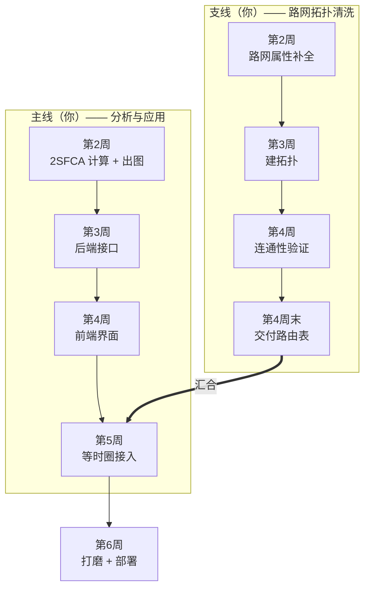

# 成都市公共服务设施可达性 WebGIS 系统
# 开发计划 v1.2（双轨并行版）

| 项 | 内容 |
| --- | --- |
| 文档版本 | v1.2 |
| 变更 | 引入 pgRouting 等时圈；路网拓扑清洗独立为并行支线 |
| 项目性质 | 个人求职作品集，**目标岗位偏开发** |
| 投入假设 | 业余时间，每周约 10–15 小时 |
| 关联文档 | 《01-需求规格说明书》《02-技术选型文档》《03-UI设计规范》《04-指标口径说明》《05-验收测试用例》 |

---

# 一、现在处于什么位置

| 阶段 | 状态 | 说明 |
| --- | --- | --- |
| 数据工程 | ✅ 完成 | 区县 20 / 路网 20.2 万段 / POI 3,036 / 人口栅格 1 幅 |
| 口径定义 | ✅ 完成 | 2SFCA 为主指标，最近距离与缓冲区作对照 |
| 基准值 | ✅ 完成 | 关键验收值已实测并写进测试用例 |
| 代码骨架 | 🟡 已有 | 后端 3 个行政区接口，前端仅行政区图层 |
| 分析实现 | ⬜ 未开始 | 2SFCA、缓冲区、等时圈均未实现 |
| 路网路由 | ⬜ 未开始 | pgRouting 4.0.1 可用但未装，拓扑未清洗 |

**结论**：数据和口径都已坐实，接下来是纯开发工作。可以开始排期了。

---

# 二、组织方式：双轨并行

这个项目有两个人的活，但只有你一个人。所以要**明确区分"谁在等谁"**。



**关键排期约束**：

> 支线必须在**第 4 周末**交付，否则第 5 周的等时圈无法开工。
> 如果清洗比预期慢，主线不受影响（第 4 周仍能出完整界面），
> 等时圈顺延——**这不是阻塞项，是加分项**。

---

# 三、支线：路网拓扑清洗（你的任务）

## 3.1 为什么要单独拆出来

Overture 的 202,077 条路段是"制图几何"，不是"路由图"：

- 路段在路口处**不一定断开**（十字路口可能是一条穿过去的长线）
- 没有 `source` / `target` 顶点编号
- 没有通行成本（时间）
- 单行道、禁行、步行不可达等信息需要显式处理

pgRouting 要的是"图"：**边 + 顶点 + 成本**。这中间要做的活就是拓扑清洗。

## 3.2 交付物

一张表，供后续路由调用。结构如下（不是建表语句，只是约定）：

| 字段 | 类型 | 含义 |
| --- | --- | --- |
| `id` | 整数，主键 | 边的唯一编号（Overture 原 ID 是 UUID，需另建整数 ID） |
| `overture_id` | 字符串 | 保留原始 ID，便于回溯核对 |
| `source` | 整数 | 起点顶点编号 |
| `target` | 整数 | 终点顶点编号 |
| `length_m` | 浮点 | 长度，米 |
| `cost` | 浮点 | 正向通行时间，**秒** |
| `reverse_cost` | 浮点 | 反向通行时间，秒；单行或禁行填 -1 |
| `road_class` | 字符串 | 保留等级，便于按等级过滤 |
| `geom` | 线几何 | EPSG:4326 |

外加自动生成的顶点表（`pgr_createTopology` 会建），用于查节点坐标。

## 3.3 三阶段任务

### 阶段 1：属性补全（约 1–2 天）

| 任务 | 说明 |
| --- | --- |
| 生成整数 ID | 给 20 万条边编整数号，保留 UUID 映射 |
| 计算长度 | 已有 `length_m`，直接用；核对单位是米 |
| 设定步行速度 | 统一 1.2 m/s（约 4.32 km/h），`cost = length_m / 1.2` |
| 禁行处理 | 高速/快速路对步行设为不可通行（`cost = -1`） |
| 单行道识别 | 从 Overture 的 `flags` / `access_restrictions` 提取，不确定的按双向处理 |

> **不要一次性追求完美**。第一版只做"全部双向可步行"，先把拓扑跑通，
> 再回头加单行道和禁行。否则会卡在属性细节上出不来。

### 阶段 2：建拓扑（约 1 天）

核心是让路段在路口真正相交成节点。要点：

| 决策 | 建议 |
| --- | --- |
| 容差 | 0.00005 度（成都纬度约 5.5 米）。太大把平行车道并了，太小路口连不上 |
| 打断策略 | 路口自动打断 + 悬挂点保留 |
| 顶点表 | 由拓扑函数自动生成，不要手工维护 |

### 阶段 3：连通性验证（约 1–2 天）

洗完之后必须自检，否则后面算出来的等时圈会莫名其妙地小。

| 自检项 | 预期 | 不达标意味着 |
| --- | --- | --- |
| 最大连通分量占比 | **> 90%** 的边 | 容差或打断有问题 |
| 孤立顶点数 | 应很少（远郊断头路正常） | 打断过度 |
| 抽样路径可通 | 主城任意两点能算出路径 | 网络断裂 |
| 成本合理性 | 1km 路段步行成本约 833 秒 | 单位错了 |

> 这四项在《05-验收测试用例》的 R 组里有对应的正式用例。

## 3.4 常见坑（提前避）

1. **容差设太大** → 平行的辅路和主路被合并，路径算出来穿墙。
2. **忘了禁行** → 步行路径沿高速走，等时圈形状离谱。
3. **单行道全按双向** → 驾车等时圈偏大（步行无所谓，可以先不管）。
4. **顶点表没重建** → 改了边表但顶点没更新，路径查不到。
5. **几何有自相交/Z 值** → 打断时崩，先做几何清理。

---

# 四、主线：逐周计划

## 第 2 周　2SFCA 计算与出图

**目标**：不写接口，先把"算得对不对"验证掉，并出一张能看的图。

| 日 | 任务 | 产出 |
| --- | --- | --- |
| 1 | 装 pgRouting，确认环境 | 扩展可用 |
| 2 | 实现第一步：每所学校的供需比 | 中间表 |
| 3 | 实现第二步：每个格网的可达性值 | 可达性栅格 |
| 4 | 区县汇总 + 分位数分级 | 20 行统计表 |
| 5 | 用 QGIS 出一张分级设色图 | PNG |

**出口**：一张分级图 + 一份区县统计表，且与基准值对得上。

> **这一周刻意不碰后端代码**。先用 SQL 验证算法，改口径零成本。

## 第 3 周　后端接口

**目标**：把算出来的结果变成可调用的接口。

| 日 | 任务 | 产出 |
| --- | --- | --- |
| 1 | 设施统一视图 + 视口查询接口 | `/api/facilities` |
| 2 | 设施详情 + 附近检索 | `/api/facilities/{id}`、`/nearby` |
| 3 | 区县统计接口 | `/api/analysis/district-stats` |
| 4 | 最近设施接口 | `/api/analysis/nearest` |
| 5 | 接口自测 + 错误处理 + 抽稀 | 测试记录 |

**出口**：7 个接口全部可用，`curl` 能复现，性能达标。

**开发要点**（偏开发岗要能讲）：

- 所有空间查询走 GiST 索引，禁止全表扫
- 超 3000 条抽稀，返回 `truncated` 标记
- 统一错误结构，错误信息要指明具体哪里错
- 参数校验前置（bbox 格式、坐标范围）

## 第 4 周　前端界面

**目标**：从"能调接口"到"能演示"。

| 日 | 任务 | 产出 |
| --- | --- | --- |
| 1 | 三栏布局骨架 | 页面框架 |
| 2 | 图层树 + 显隐控制 | 图层管理 |
| 3 | 三类 POI 接入 + 点聚合 | 设施图层 |
| 4 | 点击弹窗 + 所属行政区 | 详情交互 |
| 5 | 分级设色专题图 + 图例 | 分析结果可视化 |

**出口**：主流程可演示，拖动不卡，防抖生效。

## 第 5 周　等时圈接入（依赖支线）

**目标**：把路网等时圈接进系统，并与直线缓冲区做对比。

| 日 | 任务 | 产出 |
| --- | --- | --- |
| 1 | 路由表接入 + 起终点吸附 | 能算路径 |
| 2 | 等时圈生成（时间阈值 → 可达节点 → 包络面） | 等时圈面 |
| 3 | 接口封装 + 缓存 | `/api/analysis/isochrone` |
| 4 | 前端等时圈图层 + 时间滑块 | 交互 |
| 5 | **与缓冲区对比出图**（关键作品集素材） | 对比图 |

**出口**：输入一个点 + 时间，输出等时圈；且面积显著小于同半径圆。

## 第 6 周　打磨与交付

| 日 | 任务 |
| --- | --- |
| 1 | 性能排查（慢查询、索引、抽稀阈值） |
| 2 | 错误态 / 空态 / 加载态统一 |
| 3 | 兼容性测试 |
| 4 | Docker 编排 + 干净环境部署 |
| 5 | 文档收尾 + 演示脚本 + README |

---

# 五、汇合点：等时圈的技术约定

两条轨道在第 5 周对接，这里定清楚接口，避免返工。

## 5.1 算法流程（描述）

```
输入：起点坐标、时间阈值（分钟）、出行方式
  ↓
① 起点吸附到路网最近顶点（超出 200m 视为不可达）
  ↓
② 从该顶点做"按成本扩散"，得到时间阈值内所有可达顶点
  ↓
③ 取这些顶点的坐标集合，做凹包（concave hull）生成面
  ↓
④ 用可达边的几何裁剪/平滑，得到等时圈多边形
  ↓
输出：面几何 + 覆盖面积 + 覆盖人口
```

## 5.2 三个要定的参数

| 参数 | 建议 | 说明 |
| --- | --- | --- |
| 扩散方向 | 无向（步行双向） | 驾车才需要考虑单行 |
| 凹包参数 | 先用平均边长 2–3 倍 | 太松退化成圆形，太紧出碎片 |
| 起点吸附阈值 | 200 米 | 超过则提示"不在可达路网内" |

## 5.3 与直线缓冲区的对比 —— 这是作品集的核心素材

同一个起点、同样"步行 1000 米"：

- 直线缓冲区：完美圆形，面积 = π×r²
- 路网等时圈：呈不规则形状，面积通常只有圆形的 **30%–70%**

**为什么面积差这么多**：因为要绕路。河、铁路、封闭小区都会让实际步行距离
远大于直线距离。这个比值本身就是"为什么值得做路网分析"的量化证据。

产出建议：一张三联图 —— 直线缓冲 / 等时圈 / 两者叠加，配一句结论。

---

# 六、里程碑与出口条件

| 里程碑 | 时间 | 交付 | 出口条件 |
| --- | --- | --- | --- |
| M1 数据与口径 | 已完成 | 数据入库、口径文档、基准值 | 全部达成 |
| M2 分析可算 | 第 2 周末 | 2SFCA 结果 + 分级图 | 与基准值一致 |
| M3 接口可用 | 第 3 周末 | 7 个接口 | 测试用例 I 组全过 |
| M4 界面可演示 | 第 4 周末 | 完整前端 | F 组全过 |
| M5 等时圈上线 | 第 5 周末 | 等时圈 + 对比图 | R 组全过 |
| M6 交付 | 第 6 周末 | 部署包 + 文档 | 干净环境一次跑通 |

---

# 七、风险与对策

| 风险 | 概率 | 影响 | 对策 |
| --- | --- | --- | --- |
| 拓扑清洗超期 | **高** | 等时圈顺延 | 等时圈是加分项，不阻塞主线；第 4 周未完成就先交付主线 |
| 2SFCA 实现错误 | 中 | 结论全错 | 小样本手算对拍（测试用例 T-A04） |
| 性能不达标 | 中 | 演示卡顿 | 第 6 周专项优化；先缓存后优化 |
| 涉猎过宽 | **高** | 什么都做不完 | 严格按 P0/P1 划分，P2 有余力再说 |
| 无时间维护 | 中 | 项目烂尾 | 每周至少留半天还债，保证可运行 |

---

# 八、偏开发岗的叙事重点

既然目标岗位偏开发，讲这个项目时**别只讲"我算出了可达性"**，
要讲工程决策。四个可展开的点：

## 8.1 数据接入的工程性

高德 API 单次只能取回约 200 条，且 `count` 字段不可信（恒为 600）。
解决办法是四叉树自适应分块，判据用**实际返回条数**而不是接口返回的总数，
超过阈值就递归切。最后 700 多次请求拿全，且做了本地缓存避免重复消耗配额。

→ 体现：不轻信第三方返回、能设计自适应算法、有配额与缓存意识。

## 8.2 坐标系与数据质量

高德/DataV 是 GCJ-02，OSM 是 WGS-84，直接叠加偏约 400 米。
用平移搜索验证（平移后平均距离从 224m 降到 64m，改善 71%）确认是基准偏移，
再做逐顶点反算纠偏。

→ 体现：会用数值方法验证假设、懂中国坐标系、对数据质量较真。

## 8.3 拓扑清洗与算法工程

Overture 的 20 万条路段是制图几何，不是路由图。要建顶点、断路口、设成本、
处理禁行，再用连通分量验证拓扑质量（最大分量 > 90% 才算可用）。

→ 体现：理解"数据 ≠ 图模型"、有验证闭环。

## 8.4 性能与接口设计（最贴合开发岗）

- 视口查询必须走空间索引，禁用 `ST_Distance < x` 这种全表扫
- 超量结果服务端抽稀，返回 `truncated` 标记而不是悄悄截断
- 分析结果不实时算，算一次存表，接口只查表
- 前端 `moveend` + 300ms 防抖，拖 10 次只发 2 个请求
- 错误结构统一，且错误信息指明具体哪个参数错了

→ 体现：有性能意识、懂接口契约、考虑过失败路径。

---

# 附：这周（第 2 周）具体做什么

```
周一  装 pgRouting，确认扩展可用；顺手把 2SFCA 的中间表设计出来
周二  写第一步（设施供需比），跑通后抽一所学校手工对拍
周三  写第二步（格网可达性），确认山区格网返回 0 而不是空
周四  区县汇总 + 分位数分级，和基准值对数
周五  QGIS 出分级设色图，截图存档

周末产出：一张图 + 一份统计表 + 一次对拍记录
```

> 本周**不写任何后端接口代码**。算法没验证对之前，接口写了也是白写。
