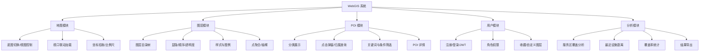

# 成都市公共服务设施空间分布与可达性 WebGIS 系统
# 需求规格说明书（块 A）

| 项目 | 内容 |
| --- | --- |
| 文档版本 | v1.0 |
| 系统名称 | 成都市公共服务设施空间分布与可达性 WebGIS 系统 |
| 文档类型 | 需求规格说明书（SRS） |
| 适用范围 | 产品、开发、测试、验收 |

---

## 1. 项目概述

### 1.1 背景

中小学与菜市场是城市最基本的公共服务设施，其空间分布是否均衡、居民步行/骑行可达性是否达标，直接影响生活便利度与公共服务均等化水平。目前成都市相关数据分散在多个业务系统与公开数据源中，缺少统一的地图化分析工具。

### 1.2 建设目标

构建一个面向城市规划与公众查询的 WebGIS 系统，实现：

1. **看得见**：在地图上直观展示成都市中小学、菜市场的空间分布；
2. **查得到**：支持按区域、类型、关键词检索设施，点击即得归属行政区与属性；
3. **算得清**：以步行服务半径与最近设施距离量化各区域的设施可达性；
4. **管得住**：支持用户登录、数据维护与图层配置，形成可持续更新的数据底座。

### 1.3 系统范围

**范围内**：成都市域内的行政区面、中小学点位、菜市场点位、可达性分析结果的可视化与查询。

**范围外（本期不做）**：

- 医院、公园、图书馆等其他设施类型（通过配置化设计预留扩展位，不实现）；
- 移动端原生 App / 小程序；
- 实时交通路况、实时人流数据接入；
- 三维城市模型、街景。

### 1.4 目标用户

| 角色 | 典型诉求 | 主要使用功能 |
| --- | --- | --- |
| 公众访客 | 查询家附近的学校、菜市场 | 地图浏览、POI 搜索、点击查询 |
| 规划/研究人员 | 评估设施覆盖是否均衡 | 可达性分析、覆盖率统计、结果导出 |
| 数据管理员 | 维护设施数据与图层配置 | 数据维护、图层管理、用户管理 |

---

## 2. 功能需求

系统划分为五大功能模块：**地图、图层、POI、用户、分析**。

### 2.1 地图模块

| 编号 | 需求 | 说明 | 优先级 |
| --- | --- | --- | --- |
| MAP-01 | 底图切换 | 提供浅色、深色、卫星影像三种底图，切换时保持视口不变 | P0 |
| MAP-02 | 视图控制 | 缩放、平移、复位到成都市域、全屏、缩放级别显示 | P0 |
| MAP-03 | 视口联动加载 | 地图 `moveend` 后按当前视口 BBOX 请求要素，300ms 防抖；缩放/平移时设施点与行政区面动态刷新 | P0 |
| MAP-04 | 坐标拾取 | 鼠标移动显示经纬度；支持点击任意位置查询所属行政区 | P0 |
| MAP-05 | 比例尺与图例 | 显示比例尺；图例随图层显隐同步变化 | P1 |
| MAP-06 | 定位到设施 | 输入设施名称/选中结果后，地图飞行定位并高亮该要素 | P1 |

**验收标准**

- 连续拖动地图 10 次，网络面板中 `/api/facilities` 请求次数 ≤ 2 次（防抖生效）；
- 视口内要素与数据库 `ST_Intersects` 结果一致，无跨视口残留要素。

### 2.2 图层模块

| 编号 | 需求 | 说明 | 优先级 |
| --- | --- | --- | --- |
| LYR-01 | 图层目录树 | 分组展示：基础底图、行政区、中小学、菜市场、分析结果；支持展开/折叠 | P0 |
| LYR-02 | 显隐控制 | 单图层开关；支持"全部显示/全部隐藏" | P0 |
| LYR-03 | 样式配置 | 点符号（颜色/大小/图标）、面填充与边框；按设施类型区分符号 | P0 |
| LYR-04 | 透明度与层级 | 支持调整图层不透明度与叠放顺序（上移/下移） | P1 |
| LYR-05 | 缩放级别策略 | 低缩放级别启用点聚合（cluster），高缩放级别展示原始点位；要素数超阈值时后端抽稀 | P0 |
| LYR-06 | 视口要素计数 | 图层项显示当前视口要素数量 | P2 |
| LYR-07 | 图层配置持久化 | 用户调整的图层状态可保存（登录用户），下次登录恢复 | P2 |

**验收标准**

- 关闭"菜市场"图层后，地图不再渲染该类要素，图例同步移除；
- 缩放至成都全域时，学校点位以聚合气泡展示，点击聚合点可展开子级。

### 2.3 POI 模块

| 编号 | 需求 | 说明 | 优先级 |
| --- | --- | --- | --- |
| POI-01 | 分类展示 | 支持"小学 / 中学 / 菜市场"分类筛选，可多选 | P0 |
| POI-02 | 点击弹窗 | 点击设施点弹出属性卡片：名称、类型、地址、所属行政区、经纬度 | P0 |
| POI-03 | 归属查询 | 基于 `ST_Contains` 判定设施所属行政区/街道，弹窗中显示 | P0 |
| POI-04 | 关键词搜索 | 按名称模糊搜索，结果列表联动地图定位 | P0 |
| POI-05 | 条件筛选 | 按行政区筛选；按与当前位置的距离排序（升序） | P1 |
| POI-06 | POI 详情 | 独立详情面板，展示完整属性与"查看服务范围"入口 | P1 |
| POI-07 | 附近设施 | 以地图点击点为圆心，查询半径 R 内设施（`ST_DWithin`），R 可调（500m/1km/2km） | P1 |

**验收标准**

- 搜索"实验小学"，返回结果均包含该关键词，点击任一结果地图中心移动至该点；
- 点击成都市中心任意点，弹窗正确显示所属区（如"武侯区"）；点击市域外点位提示"未命中行政区"。

### 2.4 用户模块

| 编号 | 需求 | 说明 | 优先级 |
| --- | --- | --- | --- |
| USR-01 | 注册/登录 | 用户名+密码注册；登录返回 JWT，前端持久化并在请求头携带 | P0 |
| USR-02 | 角色权限 | 访客（只读浏览）、普通用户（收藏、自定义图层）、管理员（数据与用户管理） | P0 |
| USR-03 | 收藏 | 收藏 POI 与地图视图（中心点+缩放级别），个人中心查看/删除 | P1 |
| USR-04 | 自定义图层 | 用户上传 CSV（名称、经度、纬度、类型）生成个人图层，仅本人可见 | P2 |
| USR-05 | 数据维护 | 管理员对设施点位的增删改（含坐标拾取录入） | P1 |
| USR-06 | 用户管理 | 管理员查看用户列表、启用/禁用账号、重置角色 | P2 |

**验收标准**

- 未登录访问受保护接口返回 401，前端跳转登录页；
- 普通用户访问管理员接口返回 403；
- Token 过期后自动清理并提示重新登录。

### 2.5 分析模块

| 编号 | 需求 | 说明 | 优先级 |
| --- | --- | --- | --- |
| ANA-01 | 服务区覆盖分析 | 以设施为圆心按服务半径（小学 500m/1000m、菜市场 500m）生成缓冲区，地图叠加展示覆盖范围 | P0 |
| ANA-02 | 覆盖率统计 | 按行政区统计：设施数量、每万人设施数、缓冲区覆盖面积占比 | P0 |
| ANA-03 | 最近设施距离 | 给定任意点（或行政区质心），计算到最近同类设施的距离（`ST_Distance`/`ST_DWithin`） | P0 |
| ANA-04 | 可达性分级 | 按最近设施距离划分"优/良/一般/差"四档，以网格或区县着色渲染 | P1 |
| ANA-05 | 分析结果导出 | 导出 GeoJSON / CSV；支持导出当前视口或全量 | P1 |
| ANA-06 | 最短路径分析 | 基于路网的最短路径与等时圈（需引入路网与 `pgRouting`，列为可选扩展） | P2 |

**验收标准**

- 选择"小学 500m"后，地图渲染缓冲区，统计面板显示覆盖面积与占比，数值与 SQL 结果一致；
- 可达性分级渲染的颜色分档与阈值配置一致，图例可解释。

### 2.6 权限矩阵

| 功能 | 访客 | 普通用户 | 管理员 |
| --- | --- | --- | --- |
| 地图浏览 / 图层切换 | ✔ | ✔ | ✔ |
| POI 搜索 / 点击查询 | ✔ | ✔ | ✔ |
| 基础分析（缓冲区、覆盖率） | ✔ | ✔ | ✔ |
| 收藏 / 自定义图层 | ✘ | ✔ | ✔ |
| 设施数据维护 | ✘ | ✘ | ✔ |
| 用户管理 | ✘ | ✘ | ✔ |

---

## 3. 数据需求

### 3.1 数据清单

| 数据 | 类型 | 关键字段 | 来源 | 更新频率 |
| --- | --- | --- | --- | --- |
| 行政区面 | Polygon/MultiPolygon | `name`、`gb`（行政区码）、`geom` | 天地图/公开行政区划 | 年度 |
| 小学 | Point | `name`、`address`、`type`、`district`、`geom` | 教育部门公开数据 | 学期 |
| 中学 | Point | 同上 | 同上 | 学期 |
| 菜市场 | Point | `name`、`address`、`type`、`district`、`geom` | 市场监管/公开数据 | 季度 |
| 路网（可选） | LineString | `from_node`、`to_node`、`length`、`geom` | OSM | 年度 |
| 人口数据（可选） | 区县统计 | `district`、`population` | 统计年鉴 | 年度 |

### 3.2 数据规范

- 坐标系：统一 **EPSG:4326**（展示与接口），距离计算使用 **EPSG:4544**（成都 2000 坐标系）或 `geography` 类型，避免度单位误差；
- 几何有效性：入库前执行 `ST_IsValid` 校验，无效几何用 `ST_MakeValid` 修复；
- 空间索引：所有几何字段建立 **GiST 索引**；
- 数据质量：点位去重（同名且距离 < 50m 视为重复）、坐标落在成都市域范围内校验。

---

## 4. 非功能需求

| 类别 | 指标 |
| --- | --- |
| 性能 | 视口查询（≤ 2000 要素）响应 ≤ 500ms；分析类接口 ≤ 2s；首屏可交互 ≤ 3s |
| 容量 | 支持 5 万级设施点、单次视口返回 ≤ 3000 要素（超出抽稀） |
| 安全 | 密码 bcrypt 哈希存储；JWT 鉴权；SQL 全部参数化绑定；表名走配置白名单 |
| 兼容性 | Chrome / Edge 最新两个大版本；分辨率 1366×768 及以上 |
| 可用性 | 接口异常返回统一 JSON 错误结构，前端有兜底提示；关键操作有 loading 状态 |
| 可扩展性 | 新增设施类型只需增加配置项（表名 + 符号样式），无需改动查询逻辑 |
| 可维护性 | 前后端分离、模块化目录；后端接口有 OpenAPI 文档 |

---

## 5. 接口需求（概要）

| 方法 | 路径 | 说明 |
| --- | --- | --- |
| GET | `/api/districts` | 行政区列表 |
| GET | `/api/areas?bbox=` | 视口 BBOX 裁剪行政区面（GeoJSON） |
| GET | `/api/areas/point?lng=&lat=` | 点查面：坐标所属行政区 |
| GET | `/api/facilities?bbox=&types=&district=` | 视口内设施点查询（支持类型/行政区筛选） |
| GET | `/api/facilities/{id}` | 设施详情 |
| GET | `/api/facilities/nearby?lng=&lat=&radius=` | 附近设施（`ST_DWithin`） |
| POST | `/api/auth/register` `/api/auth/login` | 注册 / 登录 |
| GET | `/api/analysis/coverage?type=&radius=&district=` | 服务区覆盖统计 |
| GET | `/api/analysis/nearest?lng=&lat=&type=` | 最近设施距离 |
| GET | `/api/analysis/accessibility?type=` | 可达性分级结果 |

所有地理查询接口统一返回 **GeoJSON FeatureCollection**，属性放在 `properties` 中。

---

## 6. 里程碑

| 阶段 | 交付内容 |
| --- | --- |
| M1 数据与骨架 | 数据清洗入库、行政区/设施点表、后端接口骨架、地图底图与视口联动 |
| M2 查询与图层 | POI 查询/弹窗/归属判定、图层控制、点聚合 |
| M3 用户体系 | 注册登录、JWT 鉴权、角色权限、收藏 |
| M4 空间分析 | 缓冲区覆盖、覆盖率统计、最近设施距离、可达性分级、结果导出 |
| M5 打磨上线 | 性能优化、异常兜底、部署与文档 |

---

## 7. 风险与对策

| 风险 | 影响 | 对策 |
| --- | --- | --- |
| 设施数据来源不完整/不准确 | 分析结论失真 | 多源比对；提供管理员维护入口；标注数据来源与更新时间 |
| 高缩放级别点位过多 | 渲染卡顿 | 服务端抽稀 + 前端点聚合 + 视口裁剪 |
| 距离计算单位误差 | 可达性结论偏差 | 用 `geography` 或投影坐标系（EPSG:4544）计算 |
| GeoServer 与 Flask 双服务运维成本 | 部署复杂 | 统一 Docker Compose 编排；小数据量优先走 Flask GeoJSON |
| 分析接口耗时长 | 体验差 | 结果缓存（Redis）；复杂分析异步化 |
