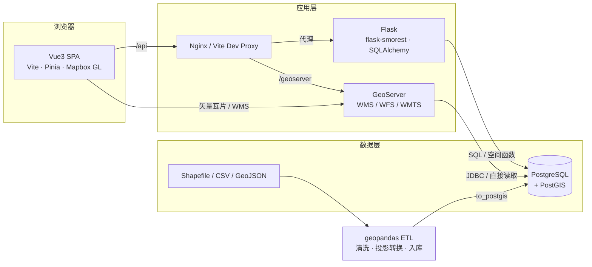
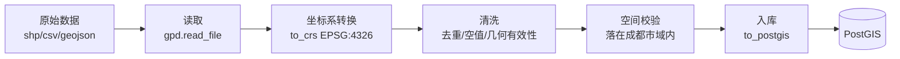
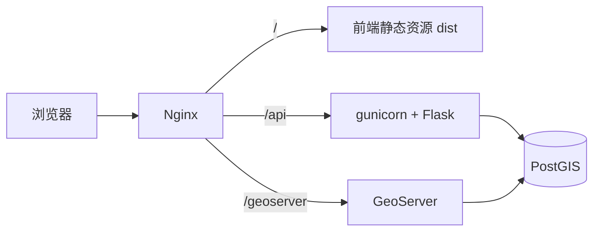

# 成都市公共服务设施空间分布与可达性 WebGIS 系统
# 技术选型文档（块 B）

| 项目 | 内容 |
| --- | --- |
| 文档版本 | v1.0 |
| 关联文档 | 《01-需求规格说明书》 |
| 文档类型 | 技术选型与架构设计 |

---

## 1. 总体架构

采用**前后端分离 + 双地理服务**架构：Flask 承担业务查询与空间分析 API，GeoServer 承担标准 OGC 地图服务（大图层渲染、SLD 样式），geopandas 作为离线数据处理（ETL）工具。



### 1.1 职责边界（关键决策）

| 职责 | 承担者 | 理由 |
| --- | --- | --- |
| 业务查询（视口检索、属性筛选、点查面、附近设施） | Flask API → GeoJSON | 数据量小、需与业务逻辑（权限、筛选）耦合，直接出 GeoJSON 最灵活 |
| 空间分析（缓冲区、覆盖率、最近距离、可达性分级） | Flask API + PostGIS 函数 | 分析逻辑需要参数化组合，SQL 表达力强、可测试 |
| 大图层渲染（全域学校/菜市场、路网） | GeoServer WMS/WMTS | 服务端切片/样式渲染，避免一次传输大量 GeoJSON |
| 标准 OGC 服务对外（WFS 下载、第三方对接） | GeoServer | 符合行业标准，便于数据共享 |
| 数据清洗与入库 | geopandas 脚本 | 一次性批处理，脚本化可复现 |

> **为什么不只用其中一个**：纯 Flask 方案在要素量大时前端 GeoJSON 体积过大；纯 GeoServer 方案则难以实现带权限的复杂业务查询与自定义分析。双轨制各取所长。

---

## 2. 前端技术选型

### 2.1 选型总览

| 类别 | 选型 | 版本建议 | 备选方案 |
| --- | --- | --- | --- |
| 框架 | Vue 3（组合式 API + `<script setup>`） | ^3.5 | React 18 |
| 构建工具 | Vite | ^8（现有工程）/ ^5 稳定版 | Webpack、Vue CLI |
| 状态管理 | Pinia | ^2.x / ^3.x | Vuex 4、provide/inject |
| 地图引擎 | Mapbox GL JS | ^3.x | OpenLayers、Leaflet、Cesium |
| HTTP 客户端 | axios（实例 + 拦截器） | ^1.7 | fetch |
| 路由 | Vue Router | ^4 | 无（单页） |
| UI 组件 | Element Plus（按需引入） | ^2.x | Naive UI、Ant Design Vue |

### 2.2 逐项说明

**Vue 3 + Vite**

- 组合式 API 便于把「地图交互」「图层控制」「POI 查询」拆成可复用的 composable（现有工程已有 `useAreaLayer`）；
- Vite 冷启动与 HMR 快，内置 `server.proxy` 解决开发跨域，无需后端开 CORS；
- 现有工程已落地，无需迁移成本。

**Pinia**

- 需要跨组件共享的状态较多：地图实例与视口、图层显隐与样式、当前筛选条件、用户 Token；
- 相比 Vuex，Pinia 无 mutations、TS 友好、支持多 store 拆分；
- 规划 store：`useMapStore`（实例/视口/底图）、`useLayerStore`（图层配置）、`useFilterStore`（筛选条件）、`useUserStore`（登录态）。

**Mapbox GL JS**

- 矢量瓦片渲染，缩放/平移流畅，支持数据驱动样式（`data-driven styling`）与点聚合（cluster）；
- 支持 GeoJSON Source 动态 `setData`，与"视口联动刷新"需求天然契合；
- 支持 3D、热力图、等时圈叠加，为分析可视化留出空间。
- **代价**：需要 Access Token（现有 `.env` 中 `VITE_TOKEN`），超出免费额度需计费；**内网/离线场景**可切换 OpenLayers + 天地图/离线瓦片。

**axios**

- 统一实例配置 `baseURL: '/api'`、超时；
- 请求拦截器：注入 JWT、过滤空参数；
- 响应拦截器：直接返回 `response.data`，错误统一提取后端 `{error.message}`，401 时清理登录态并跳转登录页。

### 2.3 前端目录规划

```
src/
├── api/            # 接口封装（http.js 实例 + 各业务模块）
├── components/     # 通用组件（MapView、LayerPanel、PoiPopup…）
├── composables/    # 组合式函数（useAreaLayer、usePoiQuery、useMapClick）
├── stores/         # Pinia（map / layer / filter / user）
├── views/          # 页面（MapPage、LoginPage、AnalysisPage）
├── router/         # 路由与守卫
├── utils/          # 工具（debounce、坐标转换、格式化）
└── assets/         # 样式与图标
```

---

## 3. 后端技术选型

### 3.1 选型总览

| 类别 | 选型 | 版本建议 | 备选方案 |
| --- | --- | --- | --- |
| Web 框架 | Flask | ^3.1 | FastAPI、Django |
| API 规范 | flask-smorest（OpenAPI + 参数校验） | ^0.47 | Flask-RESTX、手写 |
| 序列化/校验 | marshmallow | **锁定 4.x 并适配**（见 3.3） | Pydantic |
| 数据库访问 | SQLAlchemy Core（`text()`） | ^2.x | ORM、psycopg3 直连 |
| 驱动 | psycopg2-binary | ^2.9 | psycopg3 |
| 空间数据库 | PostgreSQL + PostGIS | PG 15+ / PostGIS 3.4+ | — |
| 鉴权 | Flask-JWT-Extended | ^4.x | 自建 JWT |
| 密码哈希 | Werkzeug `generate_password_hash`（bcrypt 算法） | 内置 | passlib |

### 3.2 逐项说明

**Flask + flask-smorest**

- 轻量、上手快，团队 Python 基础即可维护；
- flask-smorest 自动生成 OpenAPI 文档（`/docs`），并用 marshmallow Schema 做查询参数校验，减少手写校验；
- 已在本项目落地（`/api/cities`、`/api/areas`、`/api/areas/point`）。

**SQLAlchemy Core + 原生 SQL**

- PostGIS 的空间函数（`ST_Intersects`、`ST_Contains`、`ST_DWithin`、`ST_Buffer`）用原生 SQL 表达最直接，ORM 反而绕；
- `text()` 支持命名参数绑定，防注入；表名只来自配置白名单（`city_registry.py` 模式可扩展为 `facility_registry.py`）。

**PostGIS**

- 需求中的 BBOX 裁剪、点查面、附近查询、缓冲区分析全部由数据库完成，避免把数据搬到应用层计算；
- 关键函数与用途：

| 函数 | 用途 |
| --- | --- |
| `ST_MakeEnvelope(minx,miny,maxx,maxy,4326)` | 构造视口矩形 |
| `ST_Intersects(geom, envelope)` | 视口裁剪（走 GiST 索引） |
| `ST_Contains(polygon, point)` | 点查面（坐标归属行政区） |
| `ST_DWithin(geog, geog, meters)` | 半径内设施（用 `geography` 保证米制精度） |
| `ST_Buffer(geog, meters)` | 服务区缓冲区 |
| `ST_Distance` | 最近设施距离 |
| `ST_AsGeoJSON` | 统一输出 GeoJSON |

- 索引策略：`CREATE INDEX idx_xxx_geom ON xxx USING GIST (geom);`
- 坐标系：存储 4326；距离类计算转 `geography` 或 EPSG:4544，避免"度"当"米"用。

**Flask-JWT-Extended**

- 与 Flask 生态集成好，支持 access/refresh 双 Token、自定义 claims（角色）；
- 配合装饰器 `@jwt_required()`、`@jwt_required(roles=["admin"])` 实现角色权限（需求 USR-02）。

### 3.3 版本兼容注意事项（已踩坑，务必遵守）

| 问题 | 现象 | 处理 |
| --- | --- | --- |
| marshmallow 4.x 移除字段任意关键字参数 | `Field.__init__() got an unexpected keyword argument 'description'` | 用 `metadata={"description": ...}` |
| marshmallow 4.x 校验器签名 | `_check_xxx() got an unexpected keyword argument 'data_key'` | 校验器签名加 `**kwargs` |

> `requirements.txt` 建议限定主版本：`marshmallow>=4,<5`，避免 3.x/4.x 行为差异引发的隐性故障。

### 3.4 后端目录规划

```
backend/
├── app/
│   ├── __init__.py          # 应用工厂、异常处理
│   ├── config.py            # 配置（.env）
│   ├── extensions.py        # 引擎/会话、JWT
│   ├── models/              # 若引入 ORM（用户、收藏）
│   ├── schemas/             # marshmallow 参数与响应
│   ├── services/
│   │   ├── city_registry.py      # 行政区表配置（已有）
│   │   ├── facility_registry.py  # 设施类型→表/样式配置（新增）
│   │   ├── geo_queries.py        # 视口/点查面（已有）
│   │   ├── facility_service.py   # POI 查询与详情
│   │   └── analysis_service.py   # 缓冲区/覆盖率/可达性
│   └── resources/           # 蓝图（geo / facility / auth / analysis）
├── etl/                     # geopandas 数据处理脚本
├── tests/                   # 接口与 SQL 测试
├── requirements.txt
└── run.py
```

---

## 4. GeoServer 选型

### 4.1 定位

GeoServer 作为**标准地图服务层**，不作为业务 API 层。

| 能力 | 说明 |
| --- | --- |
| WMS | 服务端渲染图片，适合全域设施点/路网/行政区大图层 |
| WFS | 标准矢量数据下载与第三方对接 |
| WMTS | 切片服务，适合高并发只读展示 |
| SLD | 样式与地图表现解耦，可在 GeoServer 侧调整符号 |
| 数据源 | 直接读取 PostGIS 表（发布 Layer） |

### 4.2 与 Flask 的分工原则

- **需要业务逻辑/权限/参数组合** → Flask；
- **纯地图渲染、大图层、标准服务对接** → GeoServer；
- 同一条数据可同时被两者使用（Flask 出 GeoJSON 做交互查询，GeoServer 出 WMS 做底图渲染）。

### 4.3 版本与部署建议

- GeoServer 2.25+（需 JDK 17）；
- 生产环境限制 JVM 内存（`-Xmx1g` 起），关闭不需要的服务（如 WPS）；
- 通过 Nginx 反代 `/geoserver`，开发期由 Vite 代理转发，避免 CORS。

---

## 5. geopandas 选型（离线 ETL）

### 5.1 定位

一次性/定期批处理脚本，负责把原始数据（Shapefile、CSV、GeoJSON）清洗为标准表入库。

### 5.2 典型流程



### 5.3 关键实现要点

```python
import geopandas as gpd
from shapely.validation import make_valid
from sqlalchemy import create_engine

gdf = gpd.read_file("data/schools.shp")
gdf = gdf.to_crs(4326)

# 几何修复
gdf["geometry"] = gdf["geometry"].apply(
    lambda g: g if g.is_valid else make_valid(g)
)

# 范围校验（与行政区面求交）
districts = gpd.read_postgis("SELECT * FROM chengdu_city", engine, geom_col="geom")
gdf = gdf[gdf.intersects(districts.union_all())]

# 入库（需 geopandas + sqlalchemy + geoalchemy2）
gdf.to_postgis("facility_school", engine, if_exists="append", index=False)
```

**注意**

- `to_postgis` 依赖 `geoalchemy2`，且几何列需提前建好（避免自动推断出错）；
- 大批量写入建议分批（`chunksize`），入库后统一 `ANALYZE` 刷新统计信息；
- ETL 脚本应可重复执行（幂等），支持 `--truncate` 全量重刷。

---

## 6. 技术栈汇总表

| 层 | 技术 | 作用 | 状态 |
| --- | --- | --- | --- |
| 前端框架 | Vue 3 | 组件化 UI | 已用 |
| 构建 | Vite | 开发/构建/代理 | 已用 |
| 状态管理 | Pinia | 地图/图层/用户状态 | **待引入** |
| 地图 | Mapbox GL JS | 矢量地图渲染与交互 | 已用 |
| 请求 | axios | 拦截器统一处理 | 已用 |
| 后端框架 | Flask | Web 服务 | 已用 |
| API 文档 | flask-smorest | OpenAPI + 参数校验 | 已用 |
| 数据访问 | SQLAlchemy Core | 参数化 SQL | 已用 |
| 空间数据库 | PostGIS | 空间查询与分析 | 已用 |
| 地图服务 | GeoServer | WMS/WFS/WMTS | **待引入** |
| 数据处理 | geopandas | 清洗、投影转换、入库 | **待引入** |
| 鉴权 | Flask-JWT-Extended | Token 与角色 | **待引入** |

---

## 7. 开发与部署

### 7.1 开发环境

| 服务 | 端口 | 说明 |
| --- | --- | --- |
| Vite Dev Server | 5173 | `/api` → `127.0.0.1:5005`，`/geoserver` → `127.0.0.1:8080` |
| Flask | 5005 | `python run.py` |
| GeoServer | 8080 | 独立 Java 服务 |
| PostgreSQL | 5432 | 库 `gisdb`，扩展 `postgis` |

```js
// vite.config.js
server: {
  proxy: {
    '/api':       { target: 'http://127.0.0.1:5005', changeOrigin: true },
    '/geoserver': { target: 'http://127.0.0.1:8080', changeOrigin: true },
  },
}
```

### 7.2 生产部署



- 前端 `npm run build` 输出 `dist`，由 Nginx 托管；
- 后端用 `gunicorn -w 4 -b 127.0.0.1:5005 run:app`；
- 全部服务建议 Docker Compose 一键编排（`postgis` / `geoserver` / `backend` / `nginx`）。

---

## 8. 选型风险与对策

| 风险 | 说明 | 对策 |
| --- | --- | --- |
| Mapbox 需 Token 且计费 | 加载量超限产生费用 | 缓存视口结果、控制请求频率；内网场景切 OpenLayers + 离线瓦片 |
| GeoServer 资源占用高 | JVM 内存与启动慢 | 限制堆内存；仅发布必要图层；高并发用 WMTS 切片 |
| 双地理服务数据一致性 | Flask 与 GeoServer 读同一库 | 统一以 PostGIS 为唯一数据源，禁止各存一份 |
| geopandas 大文件内存溢出 | 全域 Shapefile 加载吃内存 | 分块读取（`bbox` 过滤）、字段裁剪、必要时改用 `ogr2ogr` + `psql \copy` |
| 距离单位误用 | 4326 下 `ST_Distance` 返回度 | 距离计算统一用 `geography` 或 EPSG:4544 |
| marshmallow 版本漂移 | 4.x 与 3.x API 不兼容 | `requirements.txt` 锁主版本，CI 中跑接口冒烟测试 |
