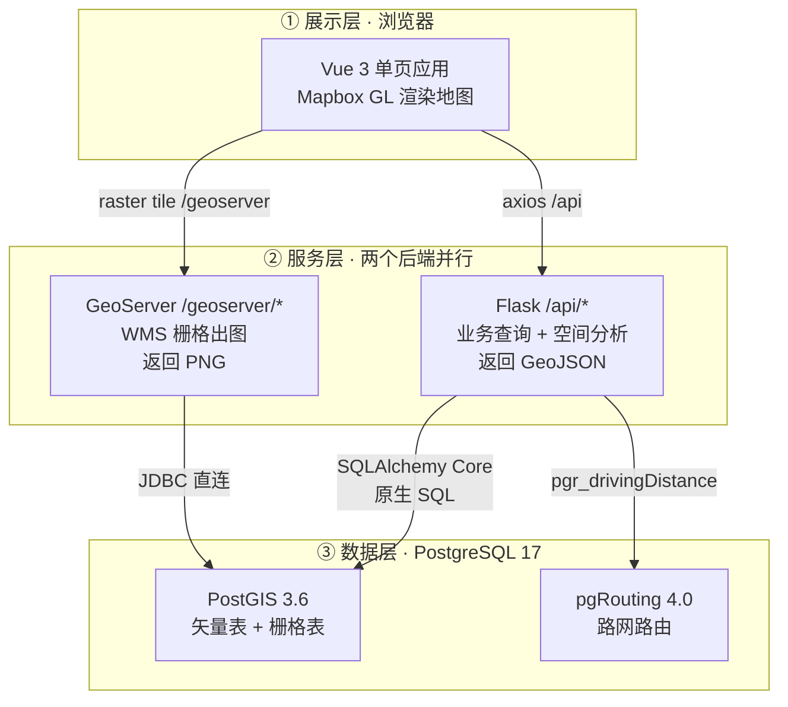
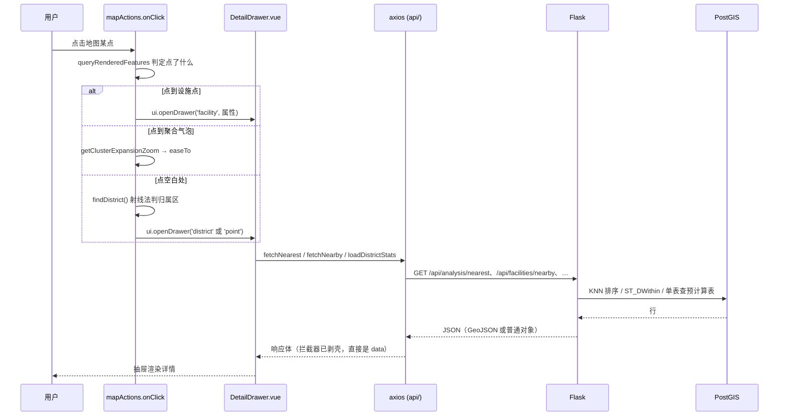
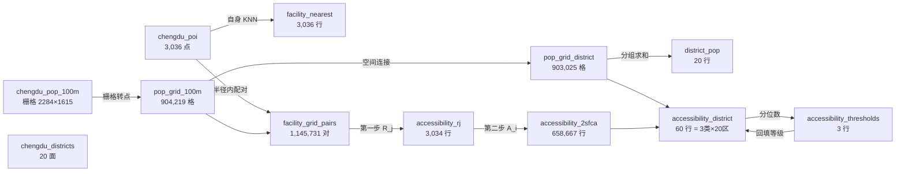
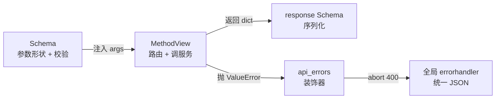
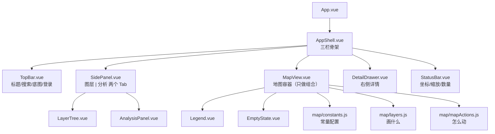
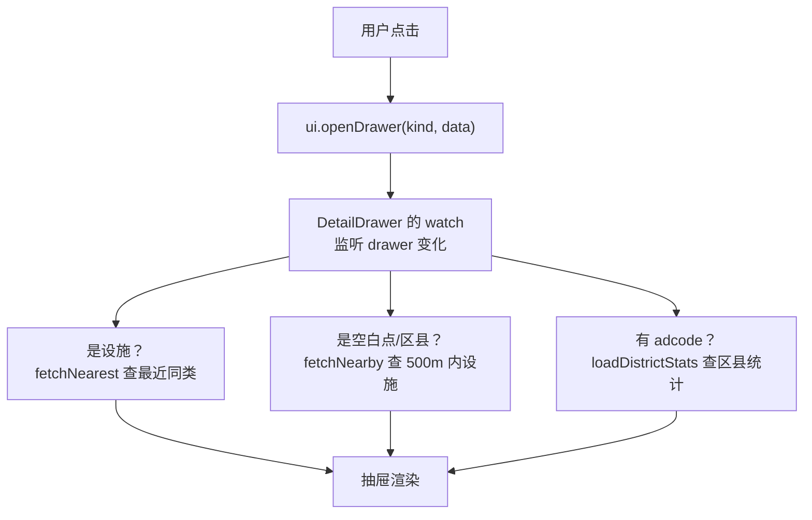
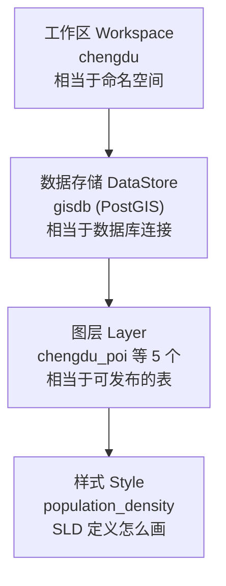

# 成都公共服务设施可达性系统 · 项目学习报告

> 目的：这份项目不是你亲手敲的，所以真正的风险不是"代码有 bug"，而是**你讲不清它**。
> 这份报告按"你能不能在面试里把它讲明白"来组织，而不是按文件目录。

| 项 | 内容 |
| --- | --- |
| 报告版本 | v1.3（2026-11-07：接上 fetchNearest，抽屉新增「最近同类设施」；订正第 0.3 节时序图） |
| 代码规模 | 后端 ~1,200 行 Python，前端 ~1,700 行 Vue/JS（含 map/ 三个模块 604 行） |
| 数据规模 | 3,036 设施点 / 202,077 路段 / 90 万人口格网 / 全域 14,486,400 人 |
| 建议阅读 | 第 0、1、5 章必读；第 7–9 章按你的岗位方向选读；第 12 章用于自测 |

> **版本说明**：
> v1.0 → v1.1：新增 9.8–9.10（设计令牌、图例形态、图层树交互），订正 10.3。
> v1.1 → v1.2：MapView 拆分为 3 个地图模块，新增 9.1.1。
> v1.2 → v1.3：接上此前未被调用的 `fetchNearest`（新增 8.1.1 与 9.11），
> 并订正第 0.3 节的请求时序图——原图把取数画在了 MapView，实际由详情抽屉发起。
> 数据侧（第 1–6 章）始终未变——**数据管道是可复现的，代码会迭代，数据不会**。

---

# 第 0 章　先建立全局心智模型

## 0.1 一句话说清这个系统

> 它把"成都每个地方到最近学校/菜市场方不方便"这个问题，
> 用 **2SFCA 算法**算成一张可查询、可分级、可视化的结果。

## 0.2 三层架构



**为什么要两个后端？** 这是全项目最容易被问的架构问题：

| 需求 | 谁来做 | 为什么 |
| --- | --- | --- |
| 查设施、算可达性、导出 | Flask | 需要业务逻辑（参数校验、抽稀、GeoJSON 组装），GeoServer 做不了 |
| 20 万路网 / 90 万格网渲染 | GeoServer | 服务端出图，浏览器只收一张 PNG，不用传几十 MB GeoJSON |
| 行政区边界 | 前端矢量 | 20 个面，数据量极小，前端直接画更灵活 |

## 0.3 一条请求的完整旅程

以"点地图某处，右边弹出详情"为例：



**这条链路的关键设计**：`onClick` 只负责"判定点了什么、打开哪个抽屉"，
真正的取数是**抽屉自己发起的**（`DetailDrawer` 的 watch 监听 `ui.drawer`）。
这样抽屉可以在任何入口被打开（地图点击、搜索、图层树），取数逻辑只有一份。

看懂这条链路，你就理解了**整个前后端协作模式**——其余接口都是这个模式的变体。

## 0.4 目录结构对照

```
PostGIS/
├── backend/                      ① 后端
│   ├── app/
│   │   ├── __init__.py           应用工厂 create_app()
│   │   ├── config.py             读 .env，OpenAPI 配置
│   │   ├── extensions.py         数据库引擎 + 会话工厂
│   │   ├── schemas/              ★ 参数校验 + 响应序列化
│   │   ├── resources/            ★ 路由（URL → 函数）
│   │   ├── services/             ★ 业务与 SQL
│   │   └── utils/                GeoJSON 组装、错误转换
│   └── scripts/build_analysis.py ★★ 全部派生表的生成脚本
├── PostGIS/                      ② 前端
│   └── src/
│       ├── stores/               ★ Pinia 状态（ui/layer/filter）
│       ├── composables/          ★ 可复用逻辑（图层、分析）
│       ├── components/           ★ 组件
│       ├── api/                  ★ axios 封装 + 各模块接口
│       └── styles/tokens.css     设计令牌
├── data_pipeline/                ③ 数据工程（Python + SQL）
└── docs/                         ④ 文档
```

**四层分工记牢**：`resources` 只负责"路由与校验"，`services` 只负责"业务与 SQL"，
`schemas` 只负责"形状"，前端 `api` 只负责"发请求"。**没有一层越界**——这是这套代码最主要的可读性来源。

---

# 第 1 章　数据血缘：从 4 张表到 18 张表

## 1.1 一开始只有什么

项目启动时，数据库里只有**原始数据**（由 `data_pipeline/` 的脚本采集入库）：

| 表 | 行数 | 是什么 | 从哪来 |
| --- | --- | --- | --- |
| `chengdu_poi` | 3,036 | 小学 1,085 / 中学 771 / 菜市场 1,180 | 高德 POI API |
| `chengdu_roads` | 202,077 | 路网线段 | Overture Maps |
| `chengdu_pop_100m` | 1 幅栅格 | 2284×1615，每格人口数 | GHSL |
| `chengdu_districts` | 20 | 区县面 | DataV（GCJ-02 已纠偏） |
| `chengdu_boundary` | 1 | 市域轮廓 | 同上 |

> 注意：**这些表是"原料"，不是"结果"**。用户要的"哪个地方可达性差"，光有它们答不出来。

## 1.2 派生表全景（血缘图）



**这张图就是"数据是怎么来的"的完整答案。** 记住它，第 5 章会逐个拆解。

## 1.3 18 张表的完整清单（实测行数）

| 表 | 行数 | 类别 | 一句话 |
| --- | --- | --- | --- |
| `chengdu_poi` | 3,036 | 原始 | 设施点 |
| `chengdu_roads` | 202,077 | 原始 | 路网 |
| `chengdu_roads_routing` | 200,881 | 派生 | 拓扑清洗后的路由边表 |
| `chengdu_roads_routing_vertices_pgr` | 168,677 | 派生 | 路由顶点 |
| `chengdu_pop_100m` | 1 | 原始 | 人口栅格 |
| `chengdu_districts` / `chengdu_boundary` / `chengdu_city` | 20 / 1 / 1 | 原始 | 行政区 |
| `pop_grid_100m` | 904,219 | 派生① | 栅格→点 |
| `pop_grid_district` | 903,025 | 派生② | 格网归区 |
| `district_pop` | 20 | 派生③ | 区县人口 |
| `facility_nearest` | 3,036 | 派生④ | 设施间距 |
| `facility_grid_pairs` | 1,145,731 | 派生⑤ | 2SFCA 邻接表 |
| `accessibility_rj` | 3,034 | 派生⑥ | 第一步供需比 |
| `accessibility_2sfca` | 658,667 | 派生⑦ | 第二步可达性 |
| `accessibility_district` | 60 | 派生⑧ | 区县汇总 |
| `accessibility_thresholds` | 3 | 派生⑨ | 分级阈值 |
| `spatial_ref_sys` | 8,500 | 系统 | PostGIS 自带坐标系表 |

## 1.4 三个能救命的数字校验

写数据管道时，**每一步都要有一个"应该相等"的数字**，否则错了你不知道。

**校验一：格网人口 = 栅格人口**

```
pop_grid_100m 合计   14,486,400
栅格原始合计         14,486,400   ← 相等，说明转点没丢数据
```

**校验二：区县人口合计 vs 格网合计**

```
district_pop 合计    14,479,788
pop_grid_100m 合计   14,486,400
差值                      6,612   (0.046%)
```

**为什么少了 6,612 人？** 因为有 **1,194 个格网没有匹配到任何区县**。
原因是区县多边形之间存在极细的缝（沿边界），格网质心正好落在缝里。
这不是 bug，是**矢量边界与栅格网格不对齐的必然现象**——但你必须在报告里能解释它。

> 面试加分点：能主动说出"我的区县人口比总数少 0.046%，因为 1,194 个边界格网没落进任何区"，
> 比说"数据完全准确"可信得多。

**校验三：R_j 行数为什么是 3,034 而不是 3,036**

```
设施总数          3,036
accessibility_rj  3,034   ← 少 2 个
```

因为 `HAVING SUM(g.pop) > 0` —— **有 2 所设施半径内一个人都没有**（深山或数据空洞），
分母为 0 无法计算供需比，被过滤掉。这是正确的防御性处理。

---

# 第 2 章　人口格网 `pop_grid_100m`：栅格为什么要变成点

## 2.1 问题：栅格不能直接做距离计算

你要算"这所学校 1 公里内有多少人"。

- 栅格存的是**二维数组**，没法直接和点做空间连接；
- PostGIS 的 `ST_DWithin` 作用于几何，不作用于栅格像元。

**所以第一步是把每个有人的像元，变成一个带人口属性的点。**

## 2.2 转换的核心函数

```sql
CREATE TABLE pop_grid_100m AS
SELECT row_number() OVER () AS cell_id,
       val::double precision  AS pop,
       geom
FROM (
    SELECT (ST_PixelAsPoints(rast, 1)).*   -- ★ 关键
    FROM chengdu_pop_100m
) t
WHERE val > 0                              -- ★ 关键
```

**`ST_PixelAsPoints(rast, 1)` 做了什么：**

它把整幅栅格"炸开"，每个像元返回一行 `(x, y, val, geom)`：

| 字段 | 含义 |
| --- | --- |
| `x`, `y` | 像元行列号 |
| `val` | 像元值（人口数） |
| `geom` | 像元**左上角**的几何点（EPSG:4326） |

> 注意 `(ST_PixelAsPoints(rast,1)).*` 这种写法：函数返回 composite 类型，
> 加括号再 `.*` 才能展开成多列。**写成 `ST_PixelAsPoints(rast,1).*` 会报错**——
> 这是 PostGIS 的一个语法坑。

**为什么 `WHERE val > 0`：**

- `val = 0` 的地方没人（公园、水面、空地），留着纯浪费——会把 368 万像元变成 368 万行；
- `val = -1` 是 nodata（市域外）；
- 过滤后剩 **904,219 行**，只保留真实有人口的位置。

## 2.3 为什么要加一列 `geography`

```sql
ALTER TABLE pop_grid_100m ADD COLUMN geog geography(Point, 4326);
UPDATE pop_grid_100m SET geog = geom::geography;
```

这是**整个项目最容易被忽略、却最关键的一行**。

| 类型 | `ST_DWithin(a, b, 1000)` 里 1000 的单位 |
| --- | --- |
| `geometry`（EPSG:4326） | **度** |
| `geography` | **米** |

在成都（北纬 30.6°），1 度纬度 ≈ 111 km，1 度经度 ≈ 96 km。
用 `geometry` 传 1000 会被理解成 **1000 度**——直接覆盖整个地球，结果全错。

所以：**判断"要不要米"→ 看类型**。凡是要按米算距离的地方，都用 `geography` 或投影坐标系。

## 2.4 索引

```sql
ALTER TABLE pop_grid_100m ADD PRIMARY KEY (cell_id);
CREATE INDEX pop_grid_100m_geom_gix ON pop_grid_100m USING GIST (geom);
CREATE INDEX pop_grid_100m_geog_gix ON pop_grid_100m USING GIST (geog);
```

- **GIST 索引**是空间查询的命门。没有它，`ST_DWithin` 会逐行算距离（90 万行 × 3000 设施）；
- 有它，先用**外接矩形**快速筛掉 99% 的行，再对剩下的算精确距离；
- `geom` 和 `geog` 各建一个，因为两种类型不能共用索引。

---

# 第 3 章　区县人口 `district_pop`：空间连接

## 3.1 两步走

**第一步：判断每个格网属于哪个区**

```sql
CREATE TABLE pop_grid_district AS
SELECT g.cell_id, d.adcode, g.pop
FROM pop_grid_100m g
JOIN chengdu_districts d ON ST_Intersects(d.geom, g.geom)
```

`ST_Intersects` = 两个几何是否**有任何接触**（包含"点在边界上"）。

**第二步：按区求和**

```sql
CREATE TABLE district_pop AS
SELECT adcode, ROUND(SUM(pop))::bigint AS pop2020
FROM pop_grid_district
GROUP BY adcode
```

## 3.2 为什么敢加主键

```sql
ALTER TABLE pop_grid_district ADD PRIMARY KEY (cell_id);
```

这句话的潜台词是：**一个格网只能属于一个区**。

如果 `ST_Intersects` 让某个格网同时命中两个区（压在两区交界线上），
主键就会冲突，建表失败——**这是一个故意的"断言"**。

实际执行成功了，说明没有格网被重复归属。这比事后写检查脚本更可靠：
**用数据库约束代替人工检查**。

## 3.3 对比：如果是两条不同写法

| 写法 | 结果 |
| --- | --- |
| `JOIN`（内连接） | 没匹配到的格网**消失** → 人口总数变少 |
| `LEFT JOIN` | 没匹配到的格网保留，`adcode` 为 NULL → 总数对得上，但分组时会出现 NULL 区 |

本项目用的是 `JOIN`，所以出现了第 1.4 节那个 **1,194 格 / 6,612 人**的缺口。
知道这个差异，你才能解释"为什么少了人"。

---

# 第 4 章　设施最近距离 `facility_nearest`：一个必须澄清的语义

## 4.1 代码

```sql
CREATE TABLE facility_nearest AS
SELECT p.poi_id, p.category, p.adcode,
       (
           SELECT ST_Distance(p.geom::geography, q.geom::geography)
           FROM chengdu_poi q
           WHERE q.category = p.category
             AND q.poi_id <> p.poi_id        -- 排除自己
           ORDER BY q.geom <-> p.geom        -- ★ KNN 排序
           LIMIT 1
       ) AS nearest_m
FROM chengdu_poi p
```

## 4.2 `<->` 是什么

`<->` 是 PostGIS 的 **KNN（K 近邻）运算符**，返回两个几何之间的**距离**，
但计算的是**外接矩形距离**（非常快，能走 GiST 索引）。

**所以这个子查询的顺序是：**

1. 用 `<->` 快速排出"外接矩形最近"的候选；
2. 取第 1 条；
3. 再用 `ST_Distance(...::geography)` 算**精确的米制距离**。

> 这是一个标准的"快排 + 精算"组合：`<->` 负责挑候选，`ST_Distance` 负责给准确数值。
> 直接 `ORDER BY ST_Distance(...)` 会全表扫描，20 万行会很慢。

**一个潜在坑**：`<->` 是矩形距离，理论上可能把"矩形最近但实际较远"的设施排在前面。
在设施密集的城区几乎不会发生，但严格来说应该用 `ORDER BY (geom::geography <-> ...)`。
**这个项目没这么做，属于可接受的近似**——面试被问到要能说出这个权衡。

## 4.3 ⚠ 语义辨析：这是"设施间距"，不是"居民到设施的距离"

这个字段叫 `nearest_m`，用在区县统计里叫 `avg_nearest_m`。
很多人的第一反应是"居民到最近设施的平均距离"——**不是**。

看 SQL：`FROM chengdu_poi p ... FROM chengdu_poi q`，**两边都是设施**。

它算的是：**每一所设施，到离它最近的同类设施有多远**。

| 指标 | 意义 | 高值说明 |
| --- | --- | --- |
| 设施间距（本表） | 设施之间的稀疏程度 | 分布稀疏 |
| 居民到设施距离 | 居民便利度 | 居民不方便 |

两者相关但不等价。**这是本项目一个真实的语义债**，你在答辩/面试时要主动说明：
"avg_nearest_m 衡量的是设施分布密度，不是居民可达性；居民可达性由 2SFCA 表达。"

> 能被问住的地方，先说出来，就变成了加分项。

---

# 第 5 章　核心：2SFCA 可达性

> 这是整个项目的技术心脏。**这一章要能脱稿讲。**

## 5.1 为什么需要它

| 方法 | 回答的问题 | 缺陷 |
| --- | --- | --- |
| 缓冲区 | 附近有没有设施 | 不管需求多少 |
| 最近距离 | 离最近的多远 | 不管设施挤不挤 |
| **2SFCA** | **人均能分到多少资源** | 计算量大 |

一句话：**缓冲区只数"有几个"，2SFCA 还看"够不够分"。**

## 5.2 公式与符号

| 符号 | 含义 | 本项目取值 |
| --- | --- | --- |
| `j` | 设施 | 1,085 / 771 / 1,180 |
| `i` | 人口格网 | 904,219 |
| `S_j` | 设施供给量 | **固定为 1**（每个设施算 1 份） |
| `P_i` | 格网人口 | 栅格值 |
| `d_0` | 服务半径 | 小学 1000m / 中学 1500m / 菜市场 500m |
| `d_ij` | 距离 | 米（geography） |

**第一步（供给侧）**：

```
R_j = S_j / Σ P_i        （对所有 d_ij ≤ d_0 的 i 求和）
```

→ 这所设施，平均每个潜在服务人口能分到多少资源。**R_j 越小越挤。**

**第二步（需求侧）**：

```
A_i = Σ R_j              （对所有 d_ij ≤ d_0 的 j 求和）
```

→ 住在这里的人，能便捷获得多少"人均资源份额"。**A_i 越大越好。**

## 5.3 关键工程技巧：为什么要先建"邻接表"

**朴素做法的问题**：直接写两步 SQL，会重复计算距离。

- 第一步要算"每个设施 × 每个格网"的距离；
- 第二步又要算一遍"每个格网 × 每个设施"的距离；
- **同一批距离算了两遍**，而距离计算是 PostgreSQL 里最贵的操作之一。

**本项目的做法**：先把"距离在半径内的所有 (设施, 格网) 对"物化成一张表。

```sql
CREATE TABLE facility_grid_pairs (
    category varchar(16), poi_id varchar(64),
    cell_id bigint, dist_m double precision,
    PRIMARY KEY (category, poi_id, cell_id)
);

-- 对每一类、每个半径分别插入
INSERT INTO facility_grid_pairs (category, poi_id, cell_id, dist_m)
SELECT p.category, p.poi_id, g.cell_id,
       ST_Distance(g.geog, p.geom::geography)
FROM chengdu_poi p
JOIN pop_grid_100m g ON ST_DWithin(g.geog, p.geom::geography, :radius)
WHERE p.category = :category
```

**这一步把 27 亿次配对压到 114 万行**：

| 方案 | 配对数 |
| --- | --- |
| 全笛卡尔积 3,036 × 904,219 | **27.4 亿** |
| `ST_DWithin` 只留半径内 | **1,145,731**（缩小 2400 倍） |

`ST_DWithin` 走 GIST 索引，先用外接矩形筛候选，再算精确距离。
**这是整个算法能跑起来的原因。**

## 5.4 第一步：R_j

```sql
CREATE TABLE accessibility_rj AS
SELECT f.category, f.poi_id,
       1.0 / NULLIF(SUM(g.pop), 0) AS r_j
FROM facility_grid_pairs f
JOIN pop_grid_100m g USING (cell_id)
GROUP BY f.category, f.poi_id
HAVING SUM(g.pop) > 0
```

逐句拆：

- `JOIN pop_grid_100m g USING (cell_id)`——把邻接表里的格网换成人口数；
- `SUM(g.pop)`——该设施半径内**总人口**（公式的分母）；
- `1.0 / NULLIF(...)`——`S_j = 1`，所以分子就是 1。`NULLIF` 防除零，避免 `division by zero` 报错；
- `HAVING SUM(g.pop) > 0`——把分母为 0 的设施整行丢掉（就是那 2 个）。

## 5.5 第二步：A_i

```sql
CREATE TABLE accessibility_2sfca AS
SELECT f.category, f.cell_id,
       SUM(r.r_j)::double precision AS a_i
FROM facility_grid_pairs f
JOIN accessibility_rj r USING (category, poi_id)
GROUP BY f.category, f.cell_id
```

- 还是查同一张邻接表（**这就是省下第二遍距离计算的关键**）；
- 把每个格网半径内的所有设施的 `r_j` 加起来。

**稀疏存储**：只存"至少有一个设施在范围内"的格网（658,667 行），
不是全部 904,219 格。没存的格网 `A_i` 视为 0——由查询时的 `COALESCE` 补上。

> 为什么可以这么省？因为远郊大量格网半径内根本没有设施，它们的 A_i 恒为 0，
> 存下来只是浪费空间。**但代价是查询时必须 `COALESCE(a_i, 0)`**，
> 忘了写就会得到 NULL，热力图上出现空洞。

## 5.6 手算一个格子（用来验证你懂没懂）

假设某格网 1 公里内有 3 所小学：

| 小学 | 半径内人口 | R_j = 1/人口 |
| --- | --- | --- |
| A | 10,000 人 | 0.0001 |
| B | 5,000 人 | 0.0002 |
| C | 20,000 人 | 0.00005 |

```
A_i = 0.0001 + 0.0002 + 0.00005 = 0.00035
```

再假设另一个格网 1 公里内只有 C 一所：

```
A_i = 0.00005
```

**结论**：第一个格子的可达性是第二个的 7 倍。
这就是为什么"学校多的地方"不一定 A_i 高——还要看**每所学校分摊多少人**。

## 5.7 为什么"中心城区反而差"

这是本项目最反直觉的结论，也是最能体现你理解深度的一点。

| 区县 | 2SFCA 值 | 等级 |
| --- | --- | --- |
| 新都区 | 0.000118 | 优 |
| 金堂县 | 0.000107 | 优 |
| ... | | |
| 郫都区 | 0.000050 | 差 |
| 金牛区 | 0.000055 | 差 |

**金牛区学校密度最高，为什么"差"？**

因为 `A_i` 衡量的是**人均供给**：

- 中心城区学校多，**但人口密度是远郊的几十倍**；
- 每所学校 1 公里内的分母（人口）极大 → `R_j` 极小 → 加起来还是小；
- 远郊学校少，但一所学校只服务几千人 → `R_j` 大 → `A_i` 大。

**正确表述**：中心城区"供不应求"，远郊"地广人稀但人均资源充足"。

**这个指标回答的是"够不够分"，不是"远不远"。** 想知道远不远，看最近距离。

---

# 第 6 章　区县可达性与分位数分级

## 6.1 人口加权平均

```sql
CREATE TABLE accessibility_district AS
SELECT c.category, d.adcode, d.name,
       COALESCE(
           SUM(pgd.pop * COALESCE(s.a_i, 0)) / NULLIF(SUM(pgd.pop), 0), 0
       )::double precision AS value,
       SUM(pgd.pop)::bigint AS pop,
       '待定'::text AS level
FROM chengdu_districts d
CROSS JOIN (SELECT DISTINCT category FROM accessibility_2sfca) c
JOIN pop_grid_district pgd ON pgd.adcode = d.adcode
LEFT JOIN accessibility_2sfca s
       ON s.cell_id = pgd.cell_id AND s.category = c.category
GROUP BY c.category, d.adcode, d.name
```

**四个看点：**

**① `CROSS JOIN` 生成 3×20 的骨架**
每个区县 × 每个设施类型都要有一行，哪怕某类设施在这个区一个都没有。
用 `CROSS JOIN` 先把骨架铺满，再用 `LEFT JOIN` 挂数据——这是"保证不丢行"的标准写法。

**② 加权平均，不是简单平均**

```
value = Σ(格网人口 × 格网可达性) / Σ(格网人口)
```

不是 `AVG(a_i)`。为什么？如果用简单平均，一个区里有 5 万个无人山区的格子（A=0），
会把城区的真实水平硬拉下来。**按人口加权，才是"平均每个居民的感受"。**

**③ 两层 `COALESCE`**
- 内层 `COALESCE(s.a_i, 0)`：稀疏存储没存到的格网视为 0；
- 外层 `COALESCE(..., 0)`：整个区如果 SUM 为 NULL（无人口），给 0。

**④ `LEFT JOIN` 而不是 `JOIN`**
如果用内连接，没有设施的格子会消失，分母变小，`value` 被高估。

## 6.2 分位数阈值

```sql
CREATE TABLE accessibility_thresholds AS
SELECT category,
       percentile_cont(0.25) WITHIN GROUP (ORDER BY value) AS p25,
       percentile_cont(0.50) WITHIN GROUP (ORDER BY value) AS p50,
       percentile_cont(0.75) WITHIN GROUP (ORDER BY value) AS p75
FROM accessibility_district
GROUP BY category
```

**为什么用分位数而不是固定阈值？**

因为 `A_i` 是**无量纲的相对值**：小学的 A_i 在 1e-5 量级，菜市场在 1e-4 量级，
而且没有物理单位。固定阈值无法跨类型复用，也无法解释。

分位数分级保证：**每档固定占 25% 的区县**，天然可解释为"最好/较好/较差/最差"。

> `percentile_cont`（连续插值）vs `percentile_disc`（取实际值）：
> 20 个数据点时 `cont` 会在两个值之间插值，`disc` 直接取原值。
> 阈值用 `cont` 更平滑。

## 6.3 回填等级

```sql
UPDATE accessibility_district a
SET level = CASE
    WHEN a.value > t.p75 THEN '优'
    WHEN a.value > t.p50 THEN '良'
    WHEN a.value > t.p25 THEN '一般'
    ELSE '差'
END
FROM accessibility_thresholds t
WHERE t.category = a.category
```

**注意是 `>` 不是 `>=`**：严格大于才对，否则 20 个区县里会有多个并列在阈值上，
导致某一档超过 25%。`CASE` 从上往下短路，第一个命中的生效。

---

# 第 7 章　后端框架：Flask + flask-smorest 的分层

## 7.1 应用工厂

```python
def create_app(config_class=Config) -> Flask:
    app = Flask(__name__)
    app.config.from_object(config_class)
    init_engine(app.config["DATABASE_URL"])     # ① 初始化数据库
    api = Api(app)                              # ② 挂 flask-smorest
    api.register_blueprint(geo_blp)             # ③ 注册三组路由
    api.register_blueprint(facility_blp)
    api.register_blueprint(analysis_blp)
    ...
    return app
```

**为什么用工厂函数而不是模块级 `app = Flask(__name__)`？**

- 测试时可以传不同的 `config_class`（连测试库）；
- 避免循环导入；
- 这是 Flask 官方推荐的结构。

## 7.2 三件套的分工



| 层 | 文件 | 只做一件事 |
| --- | --- | --- |
| **Schema** | `schemas/*.py` | 声明参数类型、必填、枚举、范围 |
| **Resource** | `resources/*.py` | URL 绑定 + 调 service + 加装饰器 |
| **Service** | `services/*.py` | 拼 SQL、执行、组装结果 |

一个接口长这样：

```python
@blp.route("/nearest")
class Nearest(MethodView):
    @blp.arguments(NearestArgs, location="query")   # 校验并注入 args
    @blp.response(200, NearestResponseSchema)       # 声明响应结构（进 OpenAPI）
    @api_errors                                      # ValueError → 400
    def get(self, args):
        return analysis_queries.nearest_facility(...)
```

**装饰器顺序有意义**：从上到下包裹，`api_errors` 最内层，才能捕获 service 抛的异常。

## 7.3 为什么用 SQLAlchemy Core 而不是 ORM

```python
# 项目里的写法
from sqlalchemy import text
sql = text("SELECT ... FROM chengdu_poi WHERE ...")
session.execute(sql, {"lng": lng, ...})
```

| 方案 | 适合 | 本项目为什么不用 |
| --- | --- | --- |
| ORM（模型类） | 增删改、关系导航 | 全是空间聚合查询，ORM 表达不了 `ST_DWithin` |
| **Core + text()** | 复杂 SQL | ✅ 参数仍能安全绑定，SQL 完全可控 |

**关键：`text()` + 字典参数 = 参数化查询**，不存在 SQL 注入。
只有表名不能参数化（这是 SQL 的限制），所以项目用**白名单**解决：

```python
CITY_TABLES = {"chengdu": {"table": "chengdu_city"}, ...}
# 表名来自这个字典，不来自用户输入
```

## 7.4 会话管理

```python
_engine = create_engine(url, pool_pre_ping=True, future=True)
_session_factory = sessionmaker(bind=_engine, expire_on_commit=False)

def get_session():
    return _session_factory()
```

- **连接池**：`create_engine` 自带，默认 5 个连接复用，不用每次建 TCP；
- `pool_pre_ping=True`：取连接前先 ping，避免用到被数据库断开的死连接；
- `with get_session() as session:` 退出时自动关闭/归还。

## 7.5 错误处理的三层

```
service 抛 ValueError("bbox 格式错误")
   ↓  @api_errors 捕获
abort(400, description="bbox 格式错误")
   ↓  全局 errorhandler
{"message": "bbox 格式错误"}   ← 前端拿到这个
```

**好处**：service 层完全不需要知道 HTTP，只关心业务；
换框架（比如换 FastAPI）时 service 一行不用改。

---

# 第 8 章　接口逐个拆解

## 8.1 六个分析接口

| 接口 | 核心 SQL 手法 | 为什么要这么写 |
| --- | --- | --- |
| `/nearest` | `ORDER BY geom <-> 点 LIMIT 1` | KNN 走索引，比全表算距离快 3 个数量级 |
| `/district-stats` | `LEFT JOIN` × 3 | 保证无设施的区县返回 0 而不是消失 |
| `/coverage` | `ST_Buffer` + `ST_Union` | 缓冲面合并成一个，避免 1000 个圆叠加 |
| `/accessibility` | 直接读 `accessibility_district` | **预计算**，接口零计算 |
| `/isochrone` | `pgr_drivingDistance` + 凹包 | 沿路网扩散，不是画圆 |
| `/export` | `Response` + `Content-Disposition` | 浏览器直接下载 |

### 8.1.1 `/nearest` 的两个细节（后加，容易忽略）

**① 必须能排除"自己"**

`nearest_facility(lng, lat, type)` 的 KNN 是"离这个点最近的同类设施"。
如果拿**某个设施自己的坐标**去查「最近同类」，它自己距离为 0，
必然排在第一位——返回的结果毫无意义。

所以加了可选参数 `exclude`（poi_id）：

```sql
WHERE category = :type
  AND (:exclude IS NULL OR poi_id <> :exclude)   -- 查自己时排掉自己
ORDER BY geom <-> ST_SetSRID(ST_MakePoint(:lng, :lat), 4326)
LIMIT 1
```

> 这是"复用接口"时最常见的坑：**为 A 场景设计的接口，用到 B 场景要先想清楚语义边界。**
> 加一个可选参数比复制一份 SQL 更干净。

**② 必须返回坐标**

```python
return {"nearest": {
    "name": ..., "distance_m": ..., "district": ..., "adcode": ...,
    "lng": float(row["lon"]), "lat": float(row["lat"]),   # ← 为前端"点击定位"服务
}}
```

只返回名称和距离的话，前端拿到"最近设施是成师附小 419.8 米"**却没法把地图飞过去**——
因为它不知道该飞到哪。**接口的返回字段要按前端的使用方式来设计，不是按数据库有什么就返回什么。**

实测（天府广场，小学）：

| 调用 | 返回 |
| --- | --- |
| 不带 `exclude` | 成师附小，419.8 m，`104.069485, 30.6550536` |
| `exclude=B0FFH94DQB` | 成都师范附属小学B区，420.5 m |
| 以成师附小坐标查 + 排除自己 | 成都市回民小学，609.3 m |

> 顺带一个真实细节：成师附小与它的 B 区相距只有 **1.8 米**（同一校区的 A/B 区），
> 所以从成师附小自身出发查「最近同类」，返回的是 1.8 米——这不是 bug，是真数据。

## 8.2 五个空间函数，什么时候用哪个

这是 GIS 开发面试的高频点：

| 函数 | 语义 | 用在哪 |
| --- | --- | --- |
| `&&` | **外接矩形**相交（极快，走索引） | 先粗筛（可省略，`ST_Intersects` 自带） |
| `ST_Intersects(a,b)` | 有任何接触（含边界） | 视口裁剪、格网归区 |
| `ST_Contains(a,b)` | b 完全在 a 内部（**不含边界**） | 点查面、设施归属 |
| `ST_DWithin(a,b,d)` | 距离 ≤ d（**走索引**） | 附近设施、半径内格网 |
| `ST_Distance(a,b)` | 精确距离（**不走索引**） | 只用于排序后的取值、显示 |

**最重要的一条：过滤用 `ST_DWithin`，不要用 `ST_Distance(...) < d`。**
后者无法走索引，会全表扫描。

## 8.3 抽稀的实现技巧

```python
"limit": limit + 1        # ★ 多查 1 条
...
truncated = len(rows) > limit
rows = rows[:limit]
```

**为什么要多查一条？**

如果查 `limit` 条，拿回 3000 条时你分不清"正好 3000"还是"被截断了"。
多查 1 条：拿到 3001 条 → 说明还有更多 → `truncated=True`。

**一行代码解决"是否截断"的歧义**，这是很典型的小技巧。

---

# 第 9 章　前端框架：Vue 3 + Pinia + Mapbox

## 9.1 组件树



## 9.1.1 地图模块的拆分（MapView 从 731 行降到 333 行）

原先 `MapView.vue` 一个文件 731 行，混了七件事：常量、图标绘制、图层定义、
显隐控制、数据请求、点击交互、生命周期。读一遍要在文件里跳来跳去。

现在拆成「一个组合层 + 三个职责文件」：

| 文件 | 行数 | 只负责 | 改动频率 |
| --- | --- | --- | --- |
| `components/MapView.vue` | 333 | 创建地图实例、绑定事件、把 store 变化同步到地图 | 低 |
| `map/constants.js` | 35 | 底图样式、市域范围、图层 id、描边色 | 极低 |
| `map/layers.js` | 383 | **画什么**：图标、WMS、矢量装饰、设施、分析结果、显隐与聚焦 | 中（调样式） |
| `map/mapActions.js` | 186 | **怎么动**：视口请求、点击三级判定、resize | 中（调交互） |

**拆分的三条依据**（这也是判断"该不该拆"的通用标准）：

1. **按变化频率拆**——调颜色只动 `layers.js`，调交互只动 `mapActions.js`，
   两者不会互相干扰；
2. **按依赖方向拆**——`mapActions` 需要 map 实例和 store，`layers` 只需要 map 实例，
   依赖是单向的，不会循环引用；
3. **不按行数拆**——`layers.js` 仍有 383 行，但它是**纯粹的 Mapbox 配置声明**，
   每个 install 函数互相独立，从上往下读一遍就能看全，切碎反而要跳五个文件。

**两个拆分时的真实坑：**

**① store 不能在模块顶层取**

```js
// ❌ 反例：layers.js 顶部
const layer = useLayerStore()
```

`layers.js` 会在 `main.js` 装载 Pinia **之前**被 import 求值，
此时调用 `useLayerStore()` 直接抛 `getActivePinia was called with no active Pinia`。
必须在函数内部取：

```js
export function applyVisibility(m) {
  const layer = useLayerStore()   // ✅ 调用发生在组件挂载后
  ...
}
```

**② 工厂函数显式注入依赖**

`mapActions.js` 没有 import store，而是导出工厂：

```js
export function createMapActions({ map, mapEl, districtsFC, lastFacilityFC, layer, filter, ui }) {
  ...
  return { loadFacilities, refresh, onClick, resizeMap, ... }
}
```

好处是依赖一目了然（看参数就知道它要什么），且这堆函数可以脱离 Vue 单独测试。
代价是 `MapView.vue` 里要多写一段传参——**这个代价是值得的**。

## 9.2 三个 store 的职责边界

这是前端设计的核心，分错了就会互相打架：

| store | 管什么 | 不管什么 |
| --- | --- | --- |
| `ui.js` | 抽屉开合、鼠标坐标、缩放级别、底图、面板收起、toast | 业务数据 |
| `layer.js` | 图层显隐、设施数量、分析结果 GeoJSON、图例派生 | 请求逻辑 |
| `filter.js` | 当前类型、半径、选中区县、关键词、**请求状态**（loading/error/count） | 地图实例 |

**一条经验**：`layer` 存"要画什么"，`filter` 存"按什么条件画"，`ui` 存"界面长什么样"。

## 9.3 为什么用 `shallowRef` 存 GeoJSON

```js
const coverageData = shallowRef(null)
```

`ref()` 会把对象**递归转成响应式代理**（深层 Proxy）。
GeoJSON 可能有 3000 个要素、每个要素几十个属性——**递归代理会卡死**。

`shallowRef` 只监听引用本身：整体替换才触发更新，内部属性变化不追踪。
**这正是 GeoJSON 的用法**（永远整体替换，不原地改）。

## 9.4 composable 模式

```js
export function useAnalysisLayer() {
  const loading = ref(false)
  const error = ref('')
  async function runCoverage({ type, radius }) { ... }
  return { loading, error, runCoverage, runAccessibility, runIsochrone }
}
```

**和 mixin 的区别**：

| | mixin | composable |
| --- | --- | --- |
| 来源 | 不知道变量从哪来 | `import` 明确 |
| 命名冲突 | 会 | 不会 |
| 类型提示 | 差 | 好 |

三个 `run*` 函数结构完全一样——这是一个**可提取的模板**：
`loading 置真 → 请求 → 存 store → 清 error → finally 置假`。

## 9.5 地图图层的装配顺序（层级）

`installLayers()` 里 `addLayer` 的**顺序就是绘制顺序**（后加的在上）：

```
人口栅格 WMS        ← 最底，铺底（带 maxzoom: 13）
区县栅格 WMS        ← 默认关闭
市界栅格 WMS        ← 默认关闭
路网 WMS
district-mask       ← 区县矢量遮罩，fill-opacity 0，只在"只看某个区"时压暗
district-line       ← 区县矢量描边 0.8px，透明度 0.55
boundary-line       ← 市界矢量描边 1.6px
设施点（三类）
覆盖分析 / 可达性 / 等时圈
选中区县高亮
点击位置标记        ← 最上
```

**当前架构的关键变化：行政区默认走矢量，WMS 降为可选。**

早期版本用 GeoServer WMS 画区县，结果整块市域被 GeoServer 的**默认灰面填充**盖住
（默认 SLD 是灰色实填充），底图全被压掉。现在的做法：

| 图层 | 默认 | 谁在画 | 颜色来源 |
| --- | --- | --- | --- |
| 区县 / 市界 | **矢量描边** | 前端 GeoJSON | `tokens.css` 的 `--c-ward-line` / `--c-city-line` |
| 区县栅格 / 市界栅格 | **关闭** | GeoServer WMS | GeoServer 默认 SLD（不可控） |

**为什么保留 WMS 图层但默认关掉？** 因为它仍是一个可用的备选（比如要做专题图时），
但只要它的颜色不受设计系统控制，就不该是默认视觉。

**规划栅格 vs 矢量时的一条通用取舍：**

- 数据量大、只要"看得见" → **WMS 栅格**（服务端出图，浏览器只收 PNG）；
- 需要"点得到、算得准" → **矢量 GeoJSON**（`queryRenderedFeatures` 对 raster 无效）。

本项目的区县只有 20 个面，矢量代价极低，所以干脆全部走矢量——
**能用矢量就别用栅格，除非数据量真的扛不住。**

## 9.6 视口联动与防抖

```js
m.on('moveend', debounce(() => {
  ui.zoom = m.getZoom()
  const c = m.getCenter()
  ui.center = { lng: c.lng, lat: c.lat }
  refresh()                      // 按新 bbox 拉设施
}, 300))
```

- 用 `moveend` 不用 `move`：`move` 每帧触发，拖动时会发几百个请求；
- 加 300ms 防抖：连续拖动时只在停下后发一次。

**验收标准**：连续拖 10 次，请求 ≤ 2 次。

## 9.7 地图事件的分层处理

```js
// 先判断点到了哪个图层，再决定行为
m.on('click', 'poi-school', (e) => openFacilityDrawer(e.features[0]))
m.on('click', (e) => { /* 空地：查附近 + 查所属区 */ })
```

**关键**：给具体图层的监听器**先于**全局监听器执行，
并且图层监听器里要 `e.originalEvent.stopPropagation?.()` 或者用标志位避免重复触发。

## 9.8 设计令牌层：`tokens.css`

前端所有颜色、字号、尺寸都收敛到一个文件：

```css
:root {
  /* 界面色 */
  --c-action: #1668dc;        /* ★ 只给"可点击动作"：按钮、tab 选中态 */
  --c-action-hover: #0e5ac4;
  --c-text: #1f2329;
  --c-text-2: #646a73;
  --c-text-disabled: #c9cdd4;

  /* 地图描边（Mapbox paint 不读 CSS 变量，需在 JS 里保持同值） */
  --c-ward-line: #8a8f99;
  --c-city-line: #1f2329;

  /* 字号 */
  --fs-ui: 13px;              /* 紧凑 UI：按钮、分组标题 */
  --fs-body: 14px;
  --fs-caption: 12px;
  --fs-number: 24px;
}
```

**三个容易被忽略的设计要点：**

**① `--c-action` 和 `--c-school` 为什么分开？**
两者当前值都是 `#1668dc`，但**语义不同**：一个表示"这里是能点的"，一个表示"这是小学"。
如果共用一个变量，将来想调按钮颜色会连带把小学涂成别的颜色。**同值不同名是刻意的**。

**② Mapbox 的 paint 读不到 CSS 变量**
`'line-color': '#8a8f99'` 只能写死字符串。所以 `MapView.vue` 顶部单独定义了常量：

```js
const WARD_LINE_COLOR = '#8a8f99'   // 与 tokens.css 的 --c-ward-line 保持同值
```

**这是一个真实的债**：改令牌时两个地方都要改。注释里已经写明对应关系。

**③ 焦点样式是显式写的**
```css
outline: 2px solid var(--c-action);
```
浏览器默认焦点环在浅色面板上几乎看不见，必须自定义——这是可访问性的最低要求。

## 9.9 图例的两种形态

`Legend.vue` 支持两类图例项：

| 形态 | 用什么数据 | 例子 |
| --- | --- | --- |
| 单一符号 | `shape` + `color` | 小学（圆点）、路网（短横线）、服务区（空心框） |
| **分档色带** | `shape: 'ramp'` + `stops[]` | 人口密度（6 档） |

色带项的结构（`layer.js`）：

```js
legendItem({
  key: 'wms-population',
  label: '人口密度（人/100m 格）',
  shape: 'ramp',
  stops: [
    { label: '≤ 5',      color: '#F6FAFD' },
    { label: '5–20',     color: '#DEE9F3' },
    { label: '20–60',    color: '#8FB4DF' },
    { label: '60–150',   color: '#F6DD84' },
    { label: '150–400',  color: '#EB8553' },
    { label: '> 400',    color: '#A4285E' },
  ],
  note: '空白表示无数据 · 缩放 ≤13 时显示',
})
```

**这里有个必须保持一致的隐形契约**：图例的 `stops` 颜色必须等于
GeoServer SLD 里 `ColorMapEntry` 的颜色。两边对不上，用户看到的图例就是错的。

> 因为 SLD 在服务端、图例在前端，**这是跨进程的耦合**，没有任何机制能自动校验。
> 改色带时必须同时改两处——记住这条。

## 9.10 图层树的三个交互细节

`LayerTree.vue` 不只是一个复选框列表：

**① 分析图层的禁用态**

```html
<input type="checkbox"
       :checked="layer.analysis.coverage"
       :disabled="!layer.coverageData" />
```

数据还没算出来时，复选框是灰的、点不动。
**这是"不可能发生的操作就不该可点"的典型实现**——比让用户点了没反应好得多。

**② 加载中的骨架屏**

```html
<SkeletonBlock v-if="!filter.stats.loaded && filter.stats.loading" :rows="3" />
```

设施数量第一次加载时显示灰条占位，避免"0 所"这种误导性数字闪一下。

**③ 人口图例用 CSS 渐变模拟色带**

```css
.dot.population {
  background: linear-gradient(90deg,
    #f6fafd 0%, #dee9f3 20%, #8fb4df 40%,
    #f6dd84 60%, #eb8553 80%, #a4285e 100%);
}
```

一个小色块要表达"6 档渐变"，用渐变背景是最省的办法。
色值同样必须与 SLD 对齐。

## 9.11 抽屉如何把三个接口串成一次点击

`DetailDrawer.vue` 是前端唯一"一次交互打三个接口"的组件。理解它，就理解了
**前端怎么把后端能力组合成用户能感知的功能**。



**三个接口各回答一个问题：**

| 区块 | 调用 | 回答 |
| --- | --- | --- |
| 顶部属性（地址/电话） | 无请求 | 点击时就把属性带过来了 |
| **最近同类设施** | `fetchNearest` | 这所学校附近还有别的同类吗？ |
| 所属行政区 | `loadDistrictStats` | 这个区整体水平如何？ |
| （空白点才有）500m 内设施 | `fetchNearby` | 站在这儿周围有什么？ |

### "最近同类设施"这一行的实现要点

```js
async function loadNearest() {
  const { lon, lat, category, poi_id: poiId } = item.value
  if (!Number.isFinite(Number(lon)) || !Number.isFinite(Number(lat)) || !category) return

  const { nearest } = await fetchNearest({
    lng: Number(lon), lat: Number(lat),
    type: category,
    exclude: poiId,        // ← 关键：不排除会返回它自己（距离 0）
  })
  nearestFacility.value = nearest ?? null
}
```

点击这一行 → `ui.fly(lng, lat, 16)` → MapView 的 `flyTo` watcher 执行 `map.flyTo`。
**定位不是"画一个标记"，而是发一条指令给地图组件**——这是 store 作为通信总线的用法。

**状态处理同样重要**，这一行有三种状态：

| 状态 | 显示 |
| --- | --- |
| 请求中 | `查询中…`（次要色小字） |
| 有结果 | 名称 + 距离，整行可点 |
| 无结果 | `周边没有其它同类设施` |

> **一个接口从"写完"到"用起来"的完整链路**：定义 API 函数 → 组件里加状态 →
> 在合适的时机触发 → 处理加载/空/错误三态 → 给出下一步操作（定位）。
> 少了任何一步，这个接口要么是死代码，要么是个用不下去的功能。

**这个项目里曾经就有一个死代码**：`fetchNearest` 写好了但前端从没调用过。
这正是"接口写完了 ≠ 功能做完了"的典型例子——**写完要接上，接上要验收**。

---

# 第 10 章　GeoServer：配置与操作详解

## 10.1 为什么需要它

Flask 出 GeoJSON 适合"小数据、要业务逻辑"；但**20 万条路网**转 GeoJSON 有 60 MB，
浏览器直接崩。

GeoServer 的价值：**服务端把数据画成图片，浏览器只收一张 PNG。**

## 10.2 三个层级概念（必须分清）



**URL 规则**：`/geoserver/{工作区}/wms`，
图层全名是 `{工作区}:{图层}`，如 `chengdu:chengdu_poi`。

## 10.3 当前配置（实测）

| 项 | 值 |
| --- | --- |
| 地址 | `http://localhost:8080/geoserver` |
| 账号 | `admin` / `geoserver` |
| 工作区 | `chengdu` |
| 数据存储 | `gisdb`（PostGIS → gisdb.public） |
| 图层 | `chengdu_boundary`、`chengdu_districts`、`chengdu_poi`、`chengdu_roads`、`population` |
| 样式 | `population_density`（仅人口栅格用，其余用默认样式） |

**发布 ≠ 使用。** 五个图层在 GeoServer 上都已发布，但前端实际默认只用到两个：

| 图层 | 前端默认 | 说明 |
| --- | --- | --- |
| `population` | 用到（可选开关） | 唯一绑定了自定义 SLD 的图层，`maxzoom: 13` |
| `chengdu_roads` | 用到（可选开关） | 20 万条线的矢量传输不可行，必须走 WMS |
| `chengdu_districts` / `chengdu_boundary` | **默认关闭** | 改用前端矢量描边，避免默认灰面 |
| `chengdu_poi` | 未用 | 设施点走 Flask GeoJSON（要查询、要交互） |

> 这条区分很重要：**"发布到 GeoServer"是能力，不等于"前端必须用"**。
> 选型标准是数据量与交互需求，不是"既然发了就得用"。

## 10.4 REST API：三个必须会的操作

**① 建工作区**

```bash
curl -u admin:geoserver -X POST -H "Content-Type: application/json" \
  -d '{"workspace":{"name":"chengdu"}}' \
  http://localhost:8080/geoserver/rest/workspaces
```

界面等价：`Workspaces → Add new workspace`

**② 建 PostGIS 数据存储**

```bash
curl -u admin:geoserver -X POST -H "Content-Type: application/json" \
  --data-binary "@datastore.json" \
  http://localhost:8080/geoserver/rest/workspaces/chengdu/datastores
```

`datastore.json` 关键字段：

```json
{"dataStore":{"name":"gisdb","type":"PostGIS","connectionParameters":{"entry":[
  {"@key":"dbtype","$":"postgis"},
  {"@key":"host","$":"127.0.0.1"},
  {"@key":"port","$":"5432"},
  {"@key":"database","$":"gisdb"},
  {"@key":"schema","$":"public"},
  {"@key":"user","$":"postgres"},
  {"@key":"passwd","$":"<DB_PASSWORD>"}
]}}}
```

界面等价：`Stores → Add new Store → PostGIS`

**③ 发布图层**

```bash
curl -u admin:geoserver -X POST -H "Content-Type: application/json" \
  -d '{"featureType":{"name":"chengdu_poi","nativeName":"chengdu_poi","srs":"EPSG:4326"}}' \
  http://localhost:8080/geoserver/rest/workspaces/chengdu/datastores/gisdb/featuretypes
```

界面等价：`Layers → Add a new resource → 选 gisdb → Publish`

## 10.5 WMS 请求 URL 逐参数拆解

前端 `src/api/geoserver.js` 拼的地址长这样：

```
/geoserver/wms?
  service=WMS
  &version=1.1.1
  &request=GetMap
  &layers=chengdu:population
  &styles=
  &format=image/png
  &transparent=true
  &srs=EPSG:3857
  &width=256
  &height=256
  &bbox={bbox-epsg-3857}      ← Mapbox 会替换成当前瓦片范围
```

| 参数 | 作用 |
| --- | --- |
| `layers` | 要画哪几层，逗号分隔（多个会叠加） |
| `styles` | 每层用什么样式，**空 = 用默认样式** |
| `transparent` | 背景透明，才能叠在底图上 |
| `srs` | 输出坐标系，**必须和地图一致**（Mapbox 用 3857） |
| `bbox` | 范围，`{bbox-epsg-3857}` 是 Mapbox 的占位符 |

**代码里的一个细节**：

```js
params.toString().replace('%7Bbbox-epsg-3857%7D', '{bbox-epsg-3857}')
```

`URLSearchParams` 会把 `{}` 编码成 `%7B%7D`，Mapbox 就不认了。
**编码后再还原**，这是个很实用的坑。

## 10.6 SLD 是什么

SLD = Styled Layer Descriptor，一份 XML，告诉 GeoServer "这条数据怎么画"。

人口栅格的 SLD 骨架：

```xml
<RasterSymbolizer>
  <ColorMap type="intervals">          <!-- 区间型：按数值段着色 -->
    <ColorMapEntry color="#FFFFFF" quantity="-1"  opacity="0"/>   <!-- nodata 透明 -->
    <ColorMapEntry color="#FFFFFF" quantity="0"   opacity="0"/>   <!-- 0 人透明 -->
    <ColorMapEntry color="#EEF5FB" quantity="1"   opacity="0.55"/> <!-- 1–5 -->
    <ColorMapEntry color="#D6E4F0" quantity="5"   opacity="0.80"/> <!-- 5–20 -->
    ...
    <ColorMapEntry color="#9C1650" quantity="400" opacity="0.92"/> <!-- >400 -->
  </ColorMap>
</RasterSymbolizer>
```

**`type="intervals"` 的语义**：每个 `quantity` 是**区间下界**。
`quantity=5` 表示 `[5, 20)` 用这个颜色。

**为什么分级按实测分位数定，不按等距？**

| 方式 | 结果 |
| --- | --- |
| 等距（0–2818 均分 5 档） | 90% 的数据落在第 1 档，其余全挤在最高档 |
| **按分位数定档** | 每一档都有可观的面积，视觉层次分明 |

## 10.7 五个必须知道的坑

| # | 坑 | 现象 | 解法 |
| --- | --- | --- | --- |
| 1 | **WMS 1.3.0 轴序** | 出图空白 | EPSG:4326 在 1.3.0 里 bbox 是**纬度在前**；用 1.1.1 或改顺序 |
| 2 | **REST 写 JSON 带 BOM** | 返回 500 | PowerShell 写文件要无 BOM |
| 3 | **默认样式灰板** | 所有面都是灰的 | 发布后手动指定样式，或前端不用 WMS 画面 |
| 4 | **raster 无 maxzoom** | 放大后像噪点 | 图层加 `maxzoom`，到某一级自动隐藏 |
| 5 | **改了 SLD 不生效** | 还是旧样子 | GeoServer 有缓存，需 `Reload` 或改图层重新绑定 |

---

# 第 11 章　你没问、但面试一定会问的六件事

## 11.1 坐标系：中国数据的头号陷阱

高德、DataV 是 **GCJ-02（火星坐标）**，OSM/GPS 是 **WGS-84**，
两者在中国相差 **300–500 米**。

本项目的处理：`data_pipeline/geo_utils.py` 实现了 GCJ-02 → WGS-84 的反算
（迭代逼近，因为正向公式没有解析逆），入库前逐顶点纠偏。

**怎么证明偏移存在？** 用平移搜索：把边界平移 (dx, dy) 找最优，
平均距离从 224.7m 降到 64.1m（改善 71.5%）→ 证明是系统性偏移，不是随机误差。

## 11.2 路网拓扑清洗

Overture 的 20 万条路段是**制图几何**，不是**路由图**：

- 没有顶点编号；
- 路口不一定断开；
- 没有通行成本。

所以 `data_pipeline/sql/02_routing_topology.sql` 做了：

1. 提取每条边的两个端点（40 万个点）；
2. **投影到 EPSG:32648 后用 5 米容差做 DBSCAN 聚类**（度不能直接当米用）；
3. 每簇生成一个顶点（取质心）；
4. 回填 `source` / `target`；
5. 设成本 `cost = length_m / 1.2`（步行 1.2 m/s，单位秒）。

**为什么不用 pgRouting 自带的 `pgr_createTopology`？** 本机这个构建里没有该函数，
所以手写了一套等价的——**反而更容易讲清楚原理**。

## 11.3 索引：为什么是 GiST

| 索引类型 | 适合 | 本项目的列 |
| --- | --- | --- |
| **GIST** | 空间数据（几何、栅格） | 所有 `geom` / `geog` |
| **B-tree** | 等值、范围、排序 | `category`、`adcode`、`poi_id` |
| GIN | 数组、全文 | 未用 |

**没有 GiST 会怎样**：`ST_Intersects` 对 20 万行逐行算几何关系，
慢两个数量级（秒级 → 分钟级）。

## 11.4 数据的诚实性（这是加分项）

必须在系统里写明的局限：

1. **人口是 2020 年 GHSL 模型估算**，成都全域 1,448.6 万，而七普是 2,093.8 万，**偏低约 31%**。
   → 所以 A_i 只能做**市内相对比较**，不能跨城市比。
2. **POI 来自高德商业数据**，不是教育/市场监管部门官方名录，有漏收和已撤并。
3. **2SFCA 与最近距离都用直线距离**，没走路网 → 结果**偏乐观**。

**主动说出这些，比假装完美可信得多。**

## 11.5 性能预算

| 场景 | 目标 | 怎么做到的 |
| --- | --- | --- |
| 视口查 2000 点 | < 500ms | GiST + 抽稀 |
| 区县统计 | < 1s | 预计算表 + 索引 |
| 等时圈 | < 3s | 顶点索引 + 凹包 |
| 首屏 | < 3s | 底图 + 矢量 |

**核心思想：重计算离线做，接口只查表。**

## 11.6 可复现性

三个脚本撑起整个数据链：

```
data_pipeline/sql/*.sql     数据处理（校验→拓扑→索引→终检）
backend/scripts/build_analysis.py   派生表生成
data_pipeline/geoserver/publish_geoserver.py   服务发布
```

每个脚本都是**幂等**的（先 DROP 再 CREATE），可以反复重跑。

---

# 第 12 章　自测题（能答出 15 题以上算掌握）

**数据层**

1. 为什么要 `ST_PixelAsPoints` 把栅格转成点？
2. `pop_grid_100m` 为什么只保留 `val > 0`？
3. `geography` 和 `geometry` 在 `ST_DWithin` 里差别是什么？
4. `pop_grid_district` 为什么敢加主键？
5. 区县人口合计比总数少 6,612 人，怎么解释？
6. `facility_nearest` 算的是"设施间距"还是"居民距离"？

**算法层**

7. 2SFCA 的 `R_j` 和 `A_i` 分别代表什么？
8. 为什么必须先建 `facility_grid_pairs`？省掉了什么？
9. `accessibility_rj` 为什么是 3,034 行而不是 3,036？
10. 为什么 `accessibility_2sfca` 可以稀疏存储？代价是什么？
11. 为什么区县可达性用人口加权而不是简单平均？
12. 为什么用分位数分级而不是固定阈值？
13. 中心城区 A_i 偏低，怎么解释？

**后端层**

14. `resources` / `services` / `schemas` 各管什么？
15. 为什么用 SQLAlchemy Core 而不是 ORM？
16. 过滤为什么用 `ST_DWithin` 而不用 `ST_Distance < x`？
17. 抽稀时多查 1 条有什么用？
18. `@api_errors` 装饰器解决了什么问题？
19. 用某个设施自己的坐标查「最近同类」，为什么会返回它自己？怎么解决？
20. 为什么 `/nearest` 要返回经纬度，只返回名称和距离不行吗？

**前端层**

21. 为什么 GeoJSON 用 `shallowRef` 而不是 `ref`？
22. 行政区为什么默认用矢量描边，而路网必须用 WMS？
23. 为什么用 `moveend` 不用 `move`？
24. 图层 `addLayer` 的顺序决定了什么？
25. `--c-action` 和 `--c-school` 值相同，为什么还要分成两个变量？
26. Mapbox 的 paint 读不到 CSS 变量，怎么处理？这带来什么隐患？
27. 图例色带的颜色与 GeoServer SLD 必须一致，但没有任何自动校验——你会怎么保证？
28. 分析图层的复选框为什么要 `:disabled="!layer.coverageData"`？
29. 人口图层为什么要加 `maxzoom: 13`？不加会怎样？
30. `fetchNearest` 曾经是死代码——一个接口"写完"和"用起来"之间还差哪些步骤？
31. 抽屉里的"最近同类设施"为什么由抽屉自己发请求，而不是 onClick 里一起取？

**GeoServer**

32. 工作区 / 数据存储 / 图层 三层是什么关系？
33. WMS 1.3.0 的 bbox 为什么容易出错？
34. SLD 的 `type="intervals"` 里 `quantity` 是什么含义？
35. "发布到 GeoServer"和"前端使用"是一回事吗？举例说明。

---

# 附录 A　从 0 复现的完整路径

```powershell
# ── 第 1 步：数据入库（已有则跳过）
cd D:\KuGou\PostGIS\data_pipeline
python 20_build_admin.py                      # 行政区（含 GCJ-02 纠偏）
python 21_build_roads.py                      # 路网
python 22_build_pop.py                        # 人口栅格
python 23_fetch_poi.py <高德Key>              # POI 抓取
python 24_rebuild_poi.py                      # POI 清洗

# ── 第 2 步：数据加工与拓扑
python run_sql.py 01_validate_data.sql        # 校验
python run_sql.py 02_routing_topology.sql     # 拓扑清洗
python run_sql.py 03_routing_cost.sql         # 成本与连通性
python run_sql.py 06_indexes.sql              # 索引
python run_sql.py 07_final_check.sql          # 终检

# ── 第 3 步：派生表（核心）
cd D:\KuGou\PostGIS
python backend/scripts/build_analysis.py      # 9 张分析表

# ── 第 4 步：发布 GeoServer
python data_pipeline/geoserver/publish_geoserver.py

# ── 第 5 步：启动服务
cd backend;  python run.py                    # :5005
cd PostGIS;  npm run dev                      # :5174
```

**每一步的验证点：**

| 步骤 | 验证 |
| --- | --- |
| 入库后 | 4 张原始表行数正确 |
| 拓扑后 | 可步行连通率 > 85% |
| 派生表后 | 18 张表齐全，人口校验通过 |
| 发布后 | WFS `numberMatched=3036` |
| 启动后 | 打开页面能看到设施点 |

---

# 附录 B　把项目"变成自己的"的四步法

**第 1 步：复述（1 天）**
不看代码，画出数据血缘图和第 0 章的三层架构图。画不出来说明没懂。

**第 2 步：改一处（1 天）**
找一个最小的改动并验证：比如把服务半径从 1000 改成 800，
重跑 `build_analysis.py`，观察 `accessibility_district` 的等级变化。
**改过的东西才是自己的。**

**第 3 步：讲一遍（2 小时）**
对着录音讲 5 分钟：项目解决什么问题 → 数据怎么来 → 2SFCA 怎么算 → 结果说明什么。
回放听哪里卡壳，那里就是你的知识缺口。

**第 4 步：答一遍（1 小时）**
把第 12 章的 25 道题全部口述一遍。答不出的回去查代码。

> 做完这四步，这个项目就不再是"agent 做的"，而是"你评审过的"。
